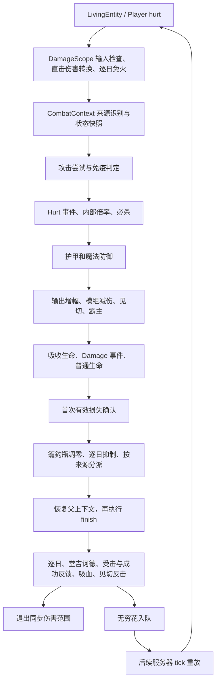

# 伤害结算与追加效果

本表用于新增伤害、增减伤、命中反馈和击杀效果时对照调用关系。源码入口以 `src/main/java/com/thelongtravail/` 为根；结构化记录见 [catalog.json](../../tools/damage-contracts/catalog.json)，变更检查与运行回归入口见[维护工具](../../tools/damage-contracts/README.md)。数值读取对应配置，本表记录金额口径和调用条件。

## 结算链

图中是阶段关系，事件取消、免疫、特殊伤害和原版受伤冷却会提前结束分支。吸收损失可能在最终生命扣除之前完成首次确认；`hurt` 返回值不等同于确认依据。

| 阶段 | 源码入口 | 关键职责 |
| --- | --- | --- |
| 服务端入口 | `mixin/LivingCombatMixin`、`mixin/PlayerCombatMixin` → `combat/DamageScope` | 非玩家与玩家分别进入；拒绝非法输入；匹配处决实例例外 |
| 来源与快照 | `helper/CombatContext` 构造 | 原来源、有效来源、逐日燃烧与最大生命快照、重放与中毒认领、特殊来源识别 |
| 事件桥接 | `mixin/FluidErosionUnavoidableMixin` | `prepareAttack`、`prepareHurt`、`finishHurt`、`finishDamage` 及外部取消记录 |
| 吸收前防御 | `mixin/DamageReplayMixin` → `beforeAbsorption` | 重放跳过已结算的原版防御；普通分支汇总输出与减伤；属性防御 |
| 实际写入 | 玩家/生物 Mixin → `CombatDamageRecord` | 生命与吸收下降记账；假人使用 `recordDummyDamage` |
| 确认 | `CombatContext.confirmDamage` | 每上下文一次；籠釣瓶与逐日在特殊来源早退之前执行 |
| 收尾 | `CombatContext.finish` | 先逐日，再按来源早退；普通分支最后结算见切反击 |
| 跨刻与死亡 | `DamageReplay`、`SoulBannerKills`、`BookRevival` 等 | 队列、死亡取消复查、击杀去重和复活会话独立维护 |

`CombatContext.close()` 先恢复父上下文，`finish()` 仍在 `DamageScope` 的同步范围内。嵌套伤害拥有自己的上下文，但共享本次同步范围的逐日认领集合。原始 `hurt` 抛异常时关闭上下文并清理同步范围，不执行正常 `finish`。

## 金额、来源与属性

| 名称 | 定义与用途 |
| --- | --- |
| 输入金额 | 传给 `hurt` 的参数，进入后续结算阶段 |
| `damageRecord.total` | 有限生命下降量与吸收下降量之和；假人可提供有效确认值；用于堂吉诃德阈值与无穷花入队 |
| `damageRecord.healthLoss` | 非负生命范围内的实际下降；第六天魔王吸血依据 |
| `damageRecord.committed` | 生命下降提交；`HEALTH_LOSS` 受击惩罚读取它，只有吸收损失不触发 |
| 原来源 | `DamageIdentity.original` 解包后的来源实例；用于派生身份、重放、处决与攻击资格 |
| 有效来源 | 籠釣瓶转换后的类型；在适用防御判断中使用，直接实体、责任实体和位置保留 |
| 责任实体 | 通常为 `getEntity()`；箭矢与近战的直接实体不同。各效果归属解析器分别生效 |

普通输出由 `outgoingBonus()` 相加后使用 `1 + 总和`：堂吉诃德、駅、花冠、伊卡洛斯、午夜拉菲、剑与灯、女仆对应加成、槲寄生、无穷花、一千年后、第六天魔王、洛伦兹幻想、逐日。`outputApplied` 阻止同一上下文重复应用。必杀另以独立乘数 2 结算，不新增 `hurt`。

内部倍率包括磷叶石受伤倍率、繁茂高生命受伤倍率、归墟环境受伤倍率、冥府输出削弱。防御汇总包括第六天魔王、堂吉诃德、槲寄生、无穷花、花冠与女仆分支，之后见切扣固定值，再由霸主比较最大生命比例阈值。各分支按来源、保护模式和固定执行顺序生效。

| 来源 | 本模组输出增幅 | 必杀 | 防御侧见切 | 霸主 |
| --- | --- | --- | --- | --- |
| 普通伤害 | 适用项相加 | 可 | 可 | 可 |
| 逐日 Strike | 无；最大生命快照乘比例 | 无 | 可 | 可 |
| 堂吉诃德 Strike | 已结算，不重复加成 | 无 | 不重复 | 可 |
| 无穷花 Replay | 重放记录金额 | 无 | 不重复 | 可 |
| 见切 Source | 普通输出加成为 0 | 可 | 可减伤，不继续反击 | 可 |
| 洛伦兹 Strike | 普通输出加成为 0 | 无 | 可 | 可 |
| 玫瑰 ROSE | 专用金额与一千年后分支 | 按属性资格 | 可减伤，不继续反击 | 可 |
| 归墟 FLUID | 专用负面与保护规则 | 无 | 无 | 无 |
| 匹配处决实例 | 专用执行路径 | 无 | 无 | 无 |

逐日的比例值不享受本模组增伤与必杀，仍受适用的目标防御影响。直击伤害转换只改变类型，不增加伤害次数，也不赋予普通攻击逐日 Strike 的早退规则。类型标签定义见 `src/main/resources/data/*/tags/damage_type/`；直击伤害规则另见[直击伤害](直击伤害.md)。

## 生成伤害的入口

| 机制 | 触发与金额 | 入口 | 终止或隔离条件 |
| --- | --- | --- | --- |
| 逐日见证 | 已确认且开头快照燃烧；目标最大生命比例 | `SunChaser.finish` | 私有 Strike 不再触发自身；`SUN_CHAIN` 每攻击者 UUID 每同步范围一次 |
| 堂吉诃德 | 已确认总损失大于 0；资格快照与当前状态；目标最大生命比例 | `DonQuixoteCombat.finish` | 专用类型、派生分支不再采样快照、收尾早退 |
| 见切 | 防御阶段记录反击值；不要求主攻击扣血 | `AttributeDamage.finish` → `InsightRetaliation.hit` | `CHAIN`、私有 Source、THORNS、ROSE、retaliation 标签；存活与伤害权限复查 |
| 玩家玫瑰丛 | 近身受击尝试；防御者最大生命比例 | `FloralEvents.received` → `FloralCombat.roseHit` | 先记录冷却；排除反伤、弹射物、爆炸 |
| 女仆玫瑰丛 | 女仆原生花冠的同类受击条件 | `MaidCombatFeedback.retaliate` | 独立冷却；共享反伤识别 |
| 无穷花 | 成功伤害概率入队；记录总损失 | `EverlastingFlower.successful` → `DamageReplay` | 普通入队与 Policy 续接分开；Frame 单次认领 |
| 洛伦兹幻想 | 弹射物命中包装后的资格；采样生命量乘比例 | `LorentzFantasy.hurtStrike` | 按目标与施法身份冷却；Strike 分支早退；不以主伤害确认作唯一条件 |
| 死告天使 | 受击/攻击状态确定处决对象 | `AzraelExecution`、`FinalExecution` | 处决实例匹配、active 作用域、终结锁；直接终结不等同于普通 hurt |
| 归墟流体侵蚀 | 日记周期惩罚 | `TrueDamage.hurtFluid` | 无攻击者；FLUID 属性豁免；逐日岩浆豁免 |
| 槲寄生 | 效果到期后的独立结算；到期最大生命快照乘等级与比例 | `Mistletoe.afterEffects` | `PENDING.remove` 单次取出；无攻击者 magic；SETTLING 在 finally 恢复 |
| 幻翼清除 | 旅程奖励中的清除行为 | `TravailRewards` | 使用玩家归属的 `playerAttack` 与 `Float.MAX_VALUE`；仍按普通来源分派 |

逐日反射只改变弹射物运动与归属；之后的碰撞重新产生伤害。洛伦兹可对命中部位调用 `hurt`，父实体用于其目标状态；部位转发进入父实体后，确认次数由实际结算上下文决定。

## 交叉触发表

“可”表示分派允许，仍需装备、阶段、目标存活、权限与冷却等资格。这里区分本模组 ROSE 与原版 THORNS。

| 当前伤害 | 逐日追加 | 籠釣瓶凋零 | 堂吉诃德追加 | 无穷花普通入队 | 见切反击 | 玫瑰反伤 | 常规确认分派 |
| --- | --- | --- | --- | --- | --- | --- | --- |
| 普通 | 可 | 可 | 可 | 可 | 可 | 近身条件可 | 可 |
| 逐日 Strike | 否 | 可 | 否 | 否 | 受 CHAIN 限制 | 否 | 否 |
| 堂吉诃德 Strike | 受本链认领限制 | 可 | 否 | 否 | 否 | 否 | 否 |
| 无穷花 Replay | 每笔新同步范围可 | 可 | 否 | 否；Policy 可续接 | 否 | 否 | 否 |
| 见切 Source | 受本链认领限制 | 可 | 否 | 否 | 否 | 否 | 否 |
| 洛伦兹 Strike | 可 | 可 | 否 | 否 | 受 CHAIN 限制 | 否 | 否 |
| 玫瑰 ROSE | 可 | 可 | 否 | 否 | 否 | 否 | 各子项筛选 |
| 匹配处决实例 | 否 | 否 | 否 | 否 | 否 | 否 | 否 |

普通确认分派为伊卡洛斯点燃、剑与灯、星之声、死告天使资格及女仆对应入口。玩家 ROSE 分派仅在总入口排除剑与灯，其余由子项判定；女仆 ROSE 分派保留星之声，在子入口排除点燃、处决与灯。

### 递归约束

派生由以下局部保护共同约束：

1. 逐日 → 见切 → 对方逐日是允许的交叉边。见切 `CHAIN` 覆盖其嵌套 `hurt` 及收尾，阻止里面再产生见切或玫瑰反伤；`SUN_CHAIN` 限制同一攻击者再次追加。
2. 堂吉诃德、重放、见切、洛伦兹等特殊分支在普通成功反馈之前返回，但逐日与籠釣瓶位于早退之前。
3. 玫瑰先占用冷却，且来源被识别为反伤；零冷却配置下仍使用反伤链保护。
4. 无穷花允许跨刻续接。队列每服务器 END tick 最多取一笔，FIFO、容量 4096；每笔重放形成新的同步范围，可再追加逐日。重放自身不走普通入队，Policy 根据确认、取消、存活、装备等条件决定下一笔。
5. 延迟任务离开当前 ThreadLocal 范围。新增长期标记或跨刻追加时，必须另外定义身份、队列上限、续接与失效条件。

新增效果需明确禁止的派生边，以及允许边的次数或续接条件；组合测试覆盖双方装备、不同派生相互触发和跨刻链。

## 不立即生成伤害的后续效果

| 效果 | 时点与入口 | 关联规则 |
| --- | --- | --- |
| 逐日禁疗与无敌帧抑制 | `SunChaser.confirmed` | 刷新截止时间；抑制正常治疗；hurt 前后清冷却；直接 setHealth 仍走其原有写入路径 |
| 籠釣瓶凋零 | `Kagotsurube.confirmed` | 无效果时新增；已有则保留等级延长；无限时长保留；延长绕过时长再次放大 |
| 花冠中毒/凋零 | `FloralEvents.successful`、女仆同名入口 | 按施加者、目标、花种冷却；丁香在效果添加入口调整时长 |
| 火焰、中毒、凋零 tick | 原版效果结算 | 原版持续伤害使用其自身 DamageSource；无源状态伤害按无责任实体结算 |
| 中毒减伤识别 | `FloralPoisonMixin` | 包装 `MobEffect.applyEffectTick`；只认领本目标一次 MAGIC；finally 恢复外层作用域 |
| 伊卡洛斯点燃 | 常规确认 | 发生在逐日快照之后，本次点燃不倒改本次燃烧资格 |
| 剑与灯、星之声 | 常规受击/确认 | 战斗状态、光源或时停；分别使用间隔、冷却与阶段 |
| 死告天使资格 | `AzraelState`、`MaidCombatFeedback` | 延迟执行时复查状态；女仆还检查世界、状态实例和代次 |
| 日记攻击/受击、磷叶石 | `TravailEvents`、`ReceivedMalice` | 攻击成功与受击尝试分开；`ReceivedHitGate` 去重 |
| 第六天魔王吸血 | `DemonKingCombat.heal` | 只用生命损失；复查同一装备实例与当前阶段；走普通 heal |
| 无穷花恶意 | `EverlastingFlower.successful` | 概率抗性提升；见证才使用重放机制 |
| 通天塔受击记录 | `CombatContext.recordProvocation` → `BabelProtection` | 生命/吸收实际损失时每上下文一次；假人专用确认不走此入口 |

## 死亡、复活与直接生命写入

| 路径 | 口径 |
| --- | --- |
| 猪笼草击杀回血 | 玩家与女仆记录死亡事件后延迟复查；死亡取消、目标仍活或施加者失效时不按正常击杀结算；独立冷却 |
| 幡收魂 | `SoulBannerKills` 回溯弹射物 owner 并防循环；排除玩家、盔甲架及配置的假人；END tick 复查事件与存活，以实体去重，并要求原装备实例仍佩戴 |
| 处决收魂 | 终结路径提交专用 forced 记录；与普通死亡记录共享去重，防重复计数 |
| 永恒之爱绑定 | `AffectionDeaths` 根据死亡结果失效关联物品；属于死亡账本而非追加伤害 |
| 书的复活资格 | `BookRevival` 保存伤害会话与死亡会话；死亡事件全部返回后接受资格，死亡完成后设 Ready |
| 处决直接终结 | `FinalExecution` 使用 `travail$commitHealth`、原版死亡与终结清理；作为独立终结入口维护 |
| 最大生命修整 | `AttributeModifierSet`、`FloralEvents.attribute` 将超过新上限的生命压回；不属于普通攻击确认 |
| 女仆法术生命同步 | `MaidSpellHealth` 直接写生命上限对应值；不自动进入 hurt 统计 |
| 处决异常值修复 | `AzraelExecution` 写回有限生命/吸收；独立于普通吸血与伤害累计 |
| 溢出治疗 | `OverflowHealing` 与 Mixin 记录有效治疗，再发放吸收；治疗调用与吸收写入分别处理 |

归属口径也独立：逐日/籠釣瓶使用 `SunBladeActors`，玩家来自 `getEntity()`，女仆经其解析器；花冠使用自己的玩家/女仆解析；幡另行回溯弹射物所有者。女仆阶段读取在线主人的日记，但效果主体、属性与同步逐日认领使用女仆自身。

## 修改时的对照顺序

`combat/DamagePolicy` 集中单次伤害的普通确认、普通收尾、攻击尝试、堂吉诃德快照、魔王快照和输出增幅资格。它使用已经识别的身份，不执行重放认领、来源转换或随机抽取。`CombatContext` 保持这些有状态操作的先后顺序；逐日与籠釣瓶仍位于普通确认早退之前。

`CombatConsequences.attackAttempt` 接收攻击尝试；`confirmedLoss` 接收生命或吸收损失确认。死亡结算使用独立死亡入口。重放与处决的认领同时检查目标和来源实例。

1. 确定触发时点：攻击尝试、实际损失确认、收尾、状态到期、跨刻任务或死亡。
2. 确定金额：输入、生命损失、总损失、最大生命快照或已结算重放；规定必杀、输出加成、防御和吸收如何处理。
3. 确定身份：原来源与有效来源、责任与直接实体、女仆主体、部位与父实体、同一来源实例认领。
4. 在交叉表中同时补充“新效果产生什么”和“新伤害能触发什么”，列出每条返回边的保护及作用域。
5. 设计取消、全吸收、归零、死亡、卸装、跨维度、实体移除、异常退出和跨刻续接场景；分别检查伤害次数、金额、来源与队列变化。
6. 更新结构化目录，运行源码复查工具；按所改分支运行 Forge 夹具。源码指纹复核后才更新基线。

## 延迟任务的失效口径

| 任务 | 保存与执行时复查 |
| --- | --- |
| 无穷花 | 保存实体弱引用、世界、来源及 Policy；出队检查实体存活、移除、世界与注册身份，Policy 检查当前阶段；卸装可取消队列及正在执行帧的续接 |
| 玩家死告天使 | 保存玩家、目标 UUID、状态实例和维度；执行前检查连接、维度、当前状态及目标存活；退出、克隆、换维度清理请求 |
| 女仆死告天使 | 保存状态实例、代次、世界与目标；复查女仆存活、移除、世界及当前状态；目标终结资格由处决入口继续检查 |
| 猪笼草回血 | 在死亡事件中快照回血比例；延迟复查事件未取消、目标死亡及施加者资格；不按幡的原装备实例规则处理 |
| 幡收魂 | 保存原装备实例；延迟检查死亡结果与同一装备，使用 COUNTED 去重；处决通过 forced 记录接入 |

这些任务的快照与兑现规则分别维护。合并公共检查时保留各自的装备身份、阶段与死亡语义；任务在执行期间新增的请求由对应队列批次规则安排。

## 伤害链诊断

默认关闭。启动 JVM 时加入 `-Dthelongtravail.damageTrace=true`，日志以 `TLT_DAMAGE` 开头，记录根调用、父子调用、目标、来源类型与责任实体、输入金额、策略、首次损失确认、逐日认领结果以及正常返回或异常退出。

- `-Dthelongtravail.damageTrace.limit=256`：单个进程最多输出的记录数，范围 1–10000，默认 256；达到限制后停止记录。
- `-Dthelongtravail.damageTrace.target=<实体UUID>`：只从指定目标开始记录，同时保留该调用的嵌套链；省略时记录所有目标。

`confirmed` 是首次有效损失时的金额快照；后续吸收或生命写入可能继续增加本笔总量。跨刻重放建立新根调用。诊断只观察调用，不改变伤害或追加次数，关闭时不创建诊断作用域。

[返回开发接入文档](README.md)
