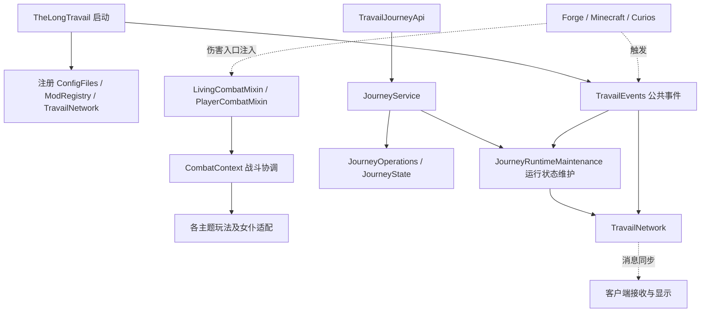

# 总体架构

## 系统边界

TLT 是运行在 Minecraft Forge 内的模组。服务端承担正式状态与玩法判定，客户端处理显示、输入及同步后的本地行为。Curios 提供装备接入；其他模组通过可选兼容进入。客户端与服务端是逻辑边界，单人游戏中也不能合并其职责。

## 职责分层

| 职责 | 代表代码 | 上层用途及边界 |
|---|---|---|
| 通用基础 | common/AttributeModifierSet、ItemDelivery；common/weighted/WeightedPicker | 属性对账、投递、抽样；依赖 Minecraft 属性、物品与实体 API |
| 领域定义与数据 | TravailAspect；journey/JourneyState、JourneyOperations、LongTravailData | 主题身份、旅程状态与数据操作；提交维护位于 journey/runtime，日记运行池、效果、属性、奖励与调度位于 runtime 下对应子包 |
| 核心协调 | JourneyService、CombatContext、TravailCurios、CarryingApi | 统一写入、伤害结算、装备与携带；部分直接引用具体物品或主题 |
| 玩法扩展 | flourishing、abyss、farreach、valley、underworld、boundless | 六主题机制；boundless/timestop 集中时停，valley/execution 集中终结执行；物品入口与机制实现按职责组织 |
| 联动边界 | integration/MaidIntegration；compat/CompatBootstrap、CompatPresets | 主体接口与缺席默认行为；具体适配和预设集中装配 |
| 平台与外部接入 | event、mixin、compat、registry、network | 注册、事件、原版注入、外部接口及网络；职责横跨不同层 |
| 客户端 | client 下的 diary、catalog、lighting、flight、visual | 界面、渲染、输入及本地授权；事件与注册入口集中装配 |
| 配套基础设施 | config、diagnostics、gradle、src/main/lang | 配置生命周期、诊断、构建与语言生成 |

## 原版注入的目录分工

`mixin` 按机制组织原版与 Forge 接入，由主 Mixin 配置注册。第三方专用注入位于 `compat/mixin`，由兼容配置及插件选择加载。

```text
mixin/
├── abyss、farreach、flourishing、underworld、valley、boundless  主题物品
├── babel、rain、timestop、execution                         独立机制
├── combat、equipment                                      战斗与装备
├── anvil、crafting、loot                                   铁砧、合成与掉落
├── interaction                                            跨主题交互入口
├── movement                                               移动速度与飞行
├── effects                                                状态效果与溢出治疗
├── presentation                                           名称、提示、字体与画面
└── world                                                  区块请求与结构环形位置
```

`interaction/GoldenAgeInteractionMixin` 在 Forge 右键事件分发后依次调用黄金时代挖掘与高频战栗。`world/ChunkFutureInvoker` 为路引、旅程到访和梦境落点搜索提交区块请求；`StructureRingsAccessor` 读取结构环形位置计算的 future。

物理端由主配置的 `mixins` 和 `client` 列表确定。`presentation/ColoringNameMixin` 是通用名称接入，其余展示注入在客户端加载；`movement/AltitudeLocalFlightMixin` 同样只在客户端加载。

## 客户端的目录分工

```text
client/
├── TravailClientEvents   Forge 订阅与公开日记入口
├── ClientSetup           客户端注册与网络接收绑定
├── BoundlessClientEvents 梦境与时停的顺序装配及退出清理
├── diary/                日记会话、键鼠路由、页面、文字与书签
├── catalog/              拾遗会话、页面、条目与文字规则
├── lighting/             灯光来源、只读快照、采样与网格重建调度
├── flight/               本地飞行授权、状态同步与伊卡洛斯翅膀
├── visual/               视觉剥夺时间线、画面参数、雾与着色器
└── timestop/             时停快照、边界渲染与提示粒子
```

TravailClientEvents 保留事件优先级和客户端加载入口；ModBus 转交 ClientSetup，界面事件转交 DiarySession 或 DiaryInputRouter。日记与拾遗都保留宿主 Screen，以覆盖层绘制内容。状态清理见 [界面会话与渲染生命周期](链路/界面会话与渲染生命周期.md#日记状态清理)。

## 配置定义的目录分工

```text
config/
├── TravailConfig                                      文件装配与公开配置句柄
├── GeneralConfigDefinition、RewardDeliveryDefinition   通用规则与奖励预算
├── UtilityItemsDefinition                             工具物品参数
├── 六主题 Definition、VisualDeprivationDefinition      主题规则与幽谷画面参数
├── TravailDefinitionSupport、TravailPoolDefaults       定义辅助与内置条目
├── 各主题 ItemsConfig、各类 CompatDefaults             物品参数与联动默认值
└── ConfigRecovery、ManagedConfig、ConfigReloadCoordinator  恢复、发布与重载协调
```

Definition 接收所属文件的 Builder，返回本组配置句柄。主题要求池显式传入；各组由 TravailConfig 顺序装配。具体文件映射见 [配置与运行时数据](模块/配置与运行时数据.md#配置定义与文件装配)。

## 主要运行链路

图中实线表示调用或装配；虚线表示框架触发或运行时传递。下图展示启动、旅程更新和伤害处理的主要入口。



关键证据入口：[启动](../../../src/main/java/com/thelongtravail/TheLongTravail.java)、[旅程 API](../../../src/main/java/com/thelongtravail/api/TravailJourneyApi.java)、[旅程服务](../../../src/main/java/com/thelongtravail/journey/JourneyService.java)、[公共事件](../../../src/main/java/com/thelongtravail/event/TravailEvents.java)、[战斗上下文](../../../src/main/java/com/thelongtravail/combat/CombatContext.java)。

## 跨模块协调

1. combat/CombatContext 在统一伤害上下文中协调六主题和饰品效果，通过 MaidIntegration 接入女仆逻辑。
2. CarryingApi.allowed 含駅和巴别塔的物品配置分支；共享 API 不意味着已经完全分离通用逻辑和物品策略。
3. JourneyService 完成数据写入后直接调用 JourneyRuntimeMaintenance 处理缓存、槽位等运行状态；TravailEvents 保留转发入口；读写数据与运行副作用存在明确连接。
4. client/flight/PrinceFlightPermission 管理本地授权；boundless/LittlePrinceFlight 负责服务端资格与状态更新，两端通过网络消息衔接。
5. Mixin、事件、资源注册和网络回调包含普通 Java 调用图无法直接表达的入口。

## 基础能力的扩展路径

| 修改目的 | 优先查阅 | 核对事项 |
|---|---|---|
| 新增属性增幅 | common/AttributeModifierSet | 来源标识、幂等更新、只清理本来源、不补造属性 |
| 外部系统推进旅程 | TravailJourneyApi → JourneyService | 服务端线程、身份与轮次、过期请求、缓存失效 |
| 新增携带来源 | CarryingApi.registerProvider | 查询三态、外部来源开关、异常和递归、生命周期 |
| 新增伤害后效果 | CombatContext 与现有伤害桥接 | 实际生命/吸收损失、嵌套、重放、处决及异常退出 |
| 新增玩法 | 对应主题实现＋物品入口 | 配置、注册、语言、图鉴、同步、兼容及验证范围 |

详细契约引用 [公共运行模块](../runtime-integration.md)；实例见 [小王子飞行](链路/小王子飞行.md)。旅程的数据分工见 [旅程与主题状态](模块/旅程与主题状态.md)，两条更新路径见 [旅程修改与探索确认](链路/旅程修改.md)。

[完整模块与链路导航](链路/README.md) · [返回项目书](README.md)
