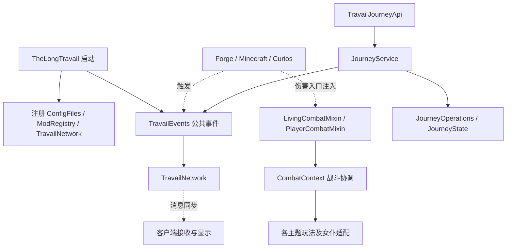

# 总体架构

## 系统边界

TLT 是运行在 Minecraft Forge 内的模组。服务端承担正式状态与玩法判定，客户端处理显示、输入及同步后的本地行为。Curios 提供装备接入；其他模组通过可选兼容进入。客户端与服务端是逻辑边界，单人游戏中也不能合并其职责。

## 职责分层

| 职责 | 代表代码 | 上层用途及边界 |
|---|---|---|
| 通用基础 | common/AttributeModifierSet、ItemDelivery；data/WeightedPicker | 属性对账、投递、抽样；仍使用游戏 API，不等于纯 Java 工具库 |
| 领域定义与数据 | TravailAspect；JourneyState、JourneyOperations、LongTravailData | 主题身份、旅程、状态与数据操作；data 包还包含其他运行机制，不能整体认定为底层 |
| 核心协调 | JourneyService、CombatContext、TravailCurios、CarryingApi | 统一写入、伤害结算、装备与携带；部分直接引用具体物品或主题 |
| 玩法扩展 | flourishing、abyss、farreach、valley、underworld、boundless | 六主题机制；物品入口与实际实现常分属不同包 |
| 平台与外部接入 | event、mixin、compat、registry、network | 注册、事件、原版注入、外部接口及网络；职责横跨不同层 |
| 客户端 | client、client/catalog，以及 PrinceFlightPermission 等 | 界面、渲染、输入及本地授权；不能只按 client 包判断物理端 |
| 配套基础设施 | config、diagnostics、gradle、src/main/lang | 配置生命周期、诊断、构建与语言生成 |

## 已核对的协作骨架

图中实线表示调用或装配；虚线表示框架触发或运行时传递。只展示主要已读入口，不表示所有依赖均严格单向。

关键证据入口：[启动](../../../src/main/java/com/thelongtravail/TheLongTravail.java)、[旅程 API](../../../src/main/java/com/thelongtravail/api/TravailJourneyApi.java)、[旅程服务](../../../src/main/java/com/thelongtravail/data/JourneyService.java)、[公共事件](../../../src/main/java/com/thelongtravail/event/TravailEvents.java)、[战斗上下文](../../../src/main/java/com/thelongtravail/helper/CombatContext.java)。

## 需要明确记录的实际耦合

1. CombatContext 在统一伤害上下文中调用具体主题、饰品和女仆逻辑，是核心协调中心，不能按 helper 包名认定为无玩法依赖的基础工具。
2. CarryingApi.allowed 含駅和巴别塔的物品配置分支；共享 API 不意味着已经完全分离通用逻辑和物品策略。
3. JourneyService 完成数据写入后调用 TravailEvents 处理缓存、槽位等运行状态；读写数据与运行副作用存在明确连接。
4. PrinceFlightPermission 位于 boundless，但职责属于客户端授权状态。包名无法独立证明运行端。
5. Mixin、事件、资源注册和网络回调包含普通 Java 调用图无法直接表达的入口。

完整循环关系、热点排序和端隔离检查尚未完成。

## 基础能力的扩展路径

| 修改目的 | 优先查阅 | 核对事项 |
|---|---|---|
| 新增属性增幅 | common/AttributeModifierSet | 来源标识、幂等更新、只清理本来源、不补造属性 |
| 外部系统推进旅程 | TravailJourneyApi → JourneyService | 服务端线程、身份与轮次、过期请求、缓存失效 |
| 新增携带来源 | CarryingApi.registerProvider | 查询三态、外部来源开关、异常和递归、生命周期 |
| 新增伤害后效果 | CombatContext 与现有伤害桥接 | 实际生命/吸收损失、嵌套、重放、处决及异常退出 |
| 新增玩法 | 对应主题实现＋物品入口 | 配置、注册、语言、图鉴、同步、兼容及验证范围 |

详细契约引用 [公共运行模块](../runtime-integration.md)；实例见 [小王子飞行](链路/小王子飞行.md)。旅程的数据分工见 [旅程与主题状态](模块/旅程与主题状态.md)，两条更新路径见 [旅程修改与探索确认](链路/旅程修改.md)。

[返回项目书](README.md)

战斗协调的职责与来源分支见 [战斗结算](模块/战斗结算.md)，作用域关闭、确认和延迟队列见 [伤害确认与重放](链路/伤害确认与重放.md)。

装备判定、恢复作用域与携带三态的分工见 [装备与携带](模块/装备与携带.md)，正常运行清退及专用卸下次序见 [装备恢复与依赖返还](链路/装备恢复与依赖返还.md)。

配置基础设施、候选发布和派生缓存见 [配置与运行时数据](模块/配置与运行时数据.md)，启动恢复与热重载分支见 [配置加载与重载](链路/配置加载与重载.md)。

局部冻结的入口分工、豁免与存储见 [时停与恢复](模块/时停与恢复.md)，队列释放、异常与停服次序见 [冻结与恢复](链路/冻结与恢复.md)。

复制图、身份与存储适配见 [外部库存复制](模块/外部库存复制.md)，提交和异常恢复见 [复制预览与领取](链路/复制预览与领取.md)。

账本事实、苏生和实体终结的职责见 [复活与终结](模块/复活与终结.md)，具体时序和失败边界见 [死亡确认、复活与终结](链路/死亡确认复活与终结.md)。

按主题、物品注册和配置查阅见 [六主题玩法功能地图](模块/六主题玩法.md)，跨层修改的检查入口见 [主题功能维护路径](链路/主题功能维护路径.md)。

物理端装配、展示状态与兼容检查见 [客户端与兼容](模块/客户端与兼容.md)，请求往返和加载实例见 [输入请求与可选加载](链路/输入请求与可选加载.md)。

源码以外的维护边界见 [工具、资源与构建](模块/工具资源与构建.md)，命令与验证层次见 [维护到构建的检查路径](链路/维护到构建的检查路径.md)。
