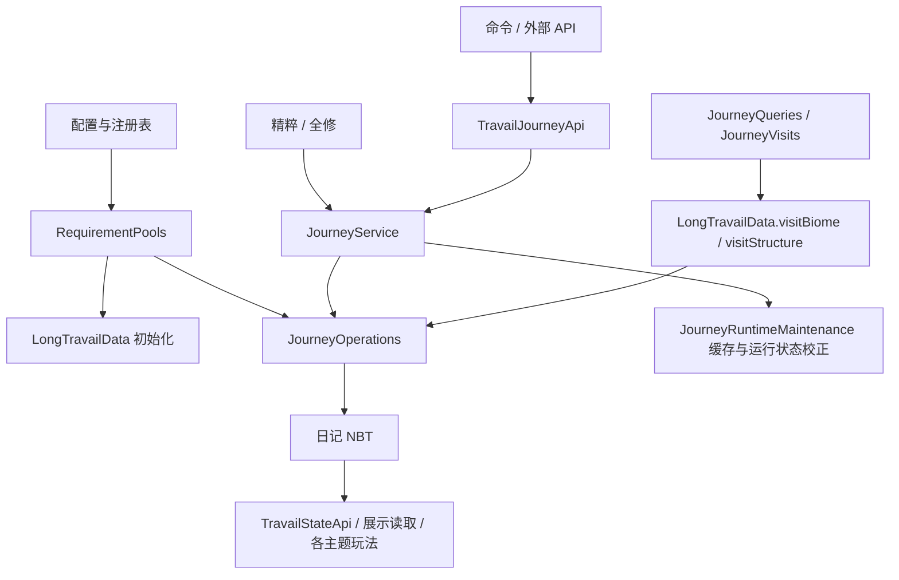

# 旅程与主题状态

核对日期：2026-10-24。本章核对核心数据、初始化、状态查询、修改提交及探索更新路径；空间匹配与路引已补充至 [探索查询与路引](探索查询与路引.md)，冥府账本见对应章节。本轮未运行游戏测试。

## 职责与阅读顺序

旅程系统把配置中的探索候选生成到日记，将到访或外部操作转换为进度和见证，再向玩法与显示提供状态。它不是单个 data 包，而是以下跨包协作模块。

| 顺序 | 入口 | 职责与层次 |
|---|---|---|
| 1 | [TravailAspect](../../../../src/main/java/com/thelongtravail/TravailAspect.java) | 六主题及位掩码，领域定义 |
| 2 | [JourneyState](../../../../src/main/java/com/thelongtravail/data/JourneyState.java) | 格式校验、主题身份、有效见证读取，领域规则 |
| 3 | [RequirementPools](../../../../src/main/java/com/thelongtravail/data/RequirementPools.java) | 配置与注册表生成候选快照，依赖配置和游戏环境 |
| 4 | [JourneyOperations](../../../../src/main/java/com/thelongtravail/data/JourneyOperations.java) | 生成主题、完成条件、重置、来源授予、调试覆盖，数据操作 |
| 5 | [LongTravailData](../../../../src/main/java/com/thelongtravail/data/LongTravailData.java) | 日记初始化、整本生成、自然到访、展示读取，物品数据协调 |
| 6 | [JourneyService](../../../../src/main/java/com/thelongtravail/data/JourneyService.java) | 服务端已装备日记的副本校验与提交，协调 Curios、消耗和事件 |
| 7 | [JourneyQueries](../../../../src/main/java/com/thelongtravail/data/JourneyQueries.java)、[JourneyVisits](../../../../src/main/java/com/thelongtravail/data/JourneyVisits.java) | 位置查询、需求缓存、延迟结构确认，运行时机制 |
| 8 | [PlayerJourneyData](../../../../src/main/java/com/thelongtravail/data/PlayerJourneyData.java) | 玩家累计发现和揭示记录，与日记分开保存 |
| 9 | [TravailStateApi](../../../../src/main/java/com/thelongtravail/api/TravailStateApi.java)、[TravailJourneyApi](../../../../src/main/java/com/thelongtravail/api/TravailJourneyApi.java) | 对外只读查询和写入入口 |

JourneyOperations 不是完全独立的纯算法层：部分重载使用 ServerPlayer 和 RequirementPools。JourneyService 也不是单纯存储层，它会调用 JourneyRuntimeMaintenance 校正运行状态。内部方法 public 不等于建议第三方直接调用。

## 数据所有权

| 数据 | 所有者/位置 | 含义 |
|---|---|---|
| Initialized、Version、JourneyId、OwnerId | 日记 ItemStack 的 LongTravail 复合标签 | 初始化、格式及整本身份；OwnerId 的写入不代表本章已确认所有权权限控制 |
| Requirements.<主题> | 同一日记标签 | Biomes/Structures 是剩余条件，CompletedBiomes/CompletedStructures 是完成记录 |
| Epoch、ThemeFormat、ConditionVersion | 单主题数据 | 新格式的主题轮次和条件格式 |
| Witnesses | 日记根标签 | 已授予见证位；既可来自条件完成，也可来自外部来源，不可等同于所有列表必然清空 |
| ForcedWitnesses、ForcedMalices | 日记根标签 | 调试覆盖，独立于真实条件进度 |
| WitnessSources、UnderworldBookWitness | 主题来源列表及冥府兼容字段 | 来源授予记录，不替代旅程轮次校验 |
| RequirementsRevision、StateRevision | 日记根标签 | 条件变更版本与状态/展示版本；不是主题 Epoch |
| visited_biomes、revealed_aspects | 玩家 PersistentData → PERSISTED_NBT_TAG → the_long_travail | 累计发现群系与解密揭示；clone 时复制 |
| 查询缓存、待确认 Observation | JourneyQueries / JourneyVisits 内存 | 可失效的运行状态，不是旅程持久化来源 |

整本重置重新生成日记的 LongTravail 标签；它不调用 PlayerJourneyData 的清空操作，因此不能理解为清空玩家所有探索历史。

## 身份和状态判定

`AspectJourneyKey = JourneyId + TravailAspect + Epoch` 用于绑定具体主题轮次。旧格式读取时以 JourneyId 充当兼容 Epoch，不因此写回迁移；损坏或不支持的格式返回无有效身份，不能回退为旧格式。

两种运行时身份不能混用：LongTravailData.RequirementIdentity 同时比较 ItemStack、根标签、Requirements 对象身份以及 JourneyId/RequirementsRevision；JourneyVisits 的内部 Identity 只取 JourneyId/RequirementsRevision，另行检查玩家、世界、存活、连接和超时。

有效见证按 `(Witnesses | ForcedWitnesses) & ~ForcedMalices & 63` 计算：强制恶意优先于强制见证，后者覆盖自然结果。清除覆盖不清空真实进度。

TravailStateApi 先查询首件已装备日记：没有日记是 INACTIVE，不是 MALICE。已装备但未初始化时，无见证位的主题按恶意读取；查询不会初始化日记。状态读取也不代表完整数据已通过格式验证，或天气、位置等具体效果条件已经满足。

## 初始化与候选池

LongTravailItem.onEquip 及服务端运行更新会调用初始化。tryInitialize 先检查存储类型和支持格式，再取得 RequirementPools 快照；已初始化数据不会在此被重新抽取，返回 supported 也不等同于逐主题完整校验。

RequirementPools 区分 DISABLED、READY、INVALID：空配置或零抽取数表示禁用；非空列表过滤后没有合法候选则阻止生成；有效候选少于要求时抽取全部有效候选。通过 WeightedPicker.withoutReplacement 生成条件。

成功生成写入 Version=2、新 JourneyId、新的各主题 Epoch、RequirementsRevision=1 和 Initialized。初始条件均为空且合法的主题会被 updateCompletion 标记完成。StateRevision 不应假设初始值也为 1；读取缺失值时采用 NBT 默认值。

主题重置与初始化不同：resetAspect 要求已有有效主题身份，拒绝 INVALID 池和零条件池；成功替换该主题、清除该主题的自然/强制位及来源，新 Epoch 使旧授予请求过期。整本重置则通过 refreshedCopy 重建 LongTravail 根标签，生成新 JourneyId。

## 上下游与两条写入路径

自然探索没有统一绕到 JourneyService；其变更会保持原日记对象，按当前路径更新查询缓存并 rebase 待确认结构。外部写入则通常要求失效旧探索和路引任务。详细过程见 [旅程修改与探索确认](../链路/旅程修改.md)。

共享读取被各主题玩法、装备规则和日记界面使用。直接消费者还包括 AspectEssenceItem、RenewalItem、TravailCommands；冥府账本也使用主题身份与来源机制，但其完整恢复流程不在本章验收范围。

## 同步和生命周期

TravailNetwork.sendJourney 的 JourneyPacket 仅发送玩家发现群系数量和揭示位，经 JourneySync 供客户端读取；它不发送全部 Requirements 或日记 NBT。日记状态通过装备/物品同步链供客户端读取，JourneyService 成功提交后调用 inventory.setChanged 与 containerMenu.broadcastChanges；不能把 sendJourney 当成完整日记同步接口。

TravailEvents 在登录时发送玩家摘要，在 clone 时复制玩家累计数据；重生、换维度、死亡和整本重置走对应运行清理，离线清除连接缓存。服务端停止清理探索和路引任务；RuntimePools.reload 会使候选池和探索缓存失效，不主动重新抽取已生成日记条件。

## 扩展入口和验证

| 需求 | 建议入口 | 必须保留 |
|---|---|---|
| 查询有效主题 | TravailStateApi.snapshot/state | INACTIVE 与 MALICE 区别、逻辑端、效果触发条件 |
| 完成指定/随机条件 | TravailJourneyApi | 服务端线程、状态结果、查询失效 |
| 延迟授予见证 | identity 后保存 AspectJourneyKey，再 grantWitness | 必须使用发起时的身份，不能在回调时重新取身份冒充原请求 |
| 新增重置方式 | 既有 resetAspect/resetJourney 协调入口 | 轮次、覆盖位、来源、槽位与缓存 |
| 修改探索确认 | JourneyQueries / JourneyVisits | 旧请求校验、同次自然多主题完成、受控 rebase |

本地隔离入口 `gradlew.bat -I tools/journey-api.init.gradle runServer` 使用 journey-api-smoke 与 smoke 中的指定夹具，工作目录 build/journey-api-server，依赖已有 run/eula.txt，使用端口 25597，并检查 journey-api-result.txt 为 PASS。本轮只核对入口，未运行；工具不保证随干净仓库提供。

后续验证应覆盖旧/新格式、损坏身份、未佩戴、重复操作、两种重置、强制恶意下授予见证、旧轮次延迟回调、同一到访完成多个主题、外部写入取消旧确认、配置重载、死亡换维度和两端显示。副作用异常后的状态需独立验证，不能以“副本提交”推断全面事务回滚。

[返回项目书](../README.md) · [接口契约](../../state-api.md)
