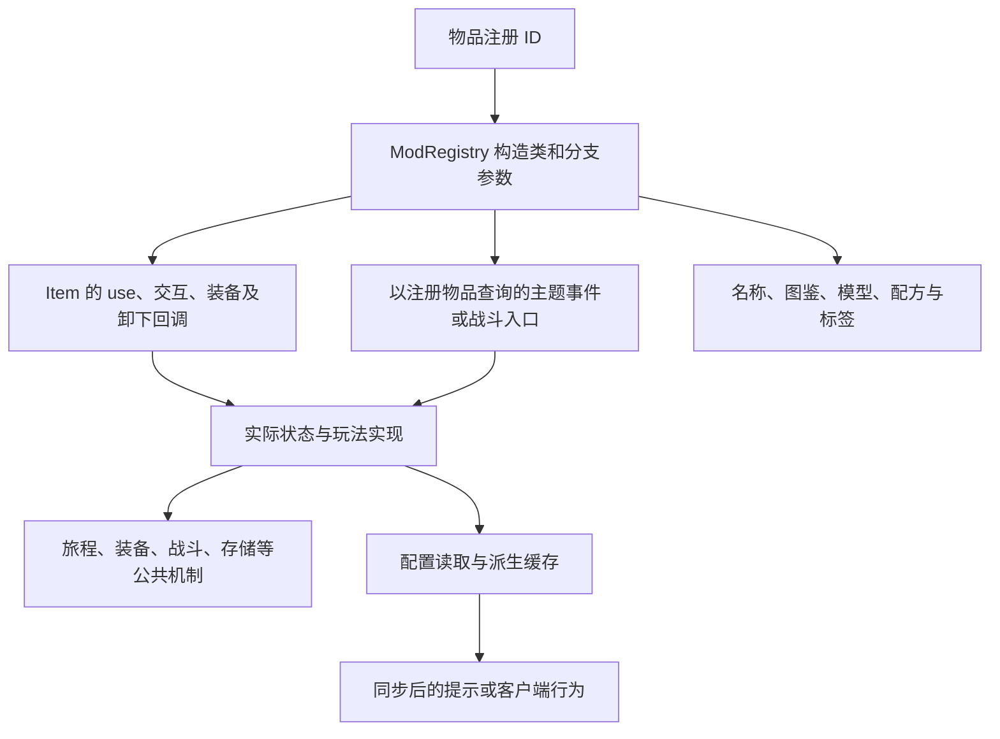

# 主题功能维护路径

本页按入口、状态与生命周期组织维护路线。注册与主题映射见 [六主题玩法](../模块/六主题玩法.md)。以下不是所有物品统一遵循的调用链。

## 从一个物品出发

实际例子：`affection` 注册为 FlourishingAccessoryItem(false)，物品交互进入 Affection.bind，潜行使用进入 Affection.clear，装备/卸下调用 Affection.reset；它没有把所有持续效果都写进物品类。`phosphophyllite` 卸下会调用 Phosphophyllite.tick，因此调整属性效果必须同时考虑卸下时的撤除。`icarus` 的物品 use 只切换开关，不足以证明飞行授权和环境判定均已覆盖。

## 从一个日记主题出发

先分清要改的是旅程身份、见证状态还是状态产生的运行效果。前两者沿 JourneyState/JourneyService 查；运行效果从 TravailEvents/TravailEffectActions 查，再追对应机制。仅修改提示或物品类，不会自然更新日记周期效果。

JourneyRuntimeMaintenance.onJourneyChanged 会按主题变化使部分缓存失效，而 onDiaryReset、重生、换维度和退出有各自清理路径。调整主题状态后应检查这些生命周期分支，不要把连接缓存、持久化诅咒截止时间和物品 NBT 一并清空。

## 按改动目的查阅

| 改动目的 | 起点 | 随后核对 |
|---|---|---|
| 调整佩戴资格 | Item.canEquip 与 AccessoryEquipRules | 日记前置、唯一性、外观槽、客户端槽位池、依赖物品返还 |
| 新增受击或伤害后效果 | CombatContext、CombatConsequences | 尝试与确认阶段、伤害来源、重放/反伤/处决、作用域重入 |
| 调整周期效果 | 主题事件与 TravailEvents | START/END、实体端别、装备查询、模式限制、卸下清理 |
| 增加配置键 | TravailConfig 的 Spec 装配及主题 ItemsConfig | 合法范围、热重载缓存、TooltipConfigSync、说明与语言占位符 |
| 修改物品文案 | ItemDescription、主题 Text 类和语言分组 | 五种语言的键顺序与参数、主题颜色、图鉴与实际运行数值 |
| 新增特殊存储/复活/冻结能力 | 已有专项模块 | 身份、保存、失败处理与跨维度生命周期，不能只复制某个回调 |

## 可复核的源码检索

从物品 ID 查 ModRegistry 获得注册常量，再搜索该常量的使用者；从类名查 [引用候选](../索引/引用候选.md) 后核对方法。事件订阅、Mixin 目标和网络 handler 都需要单独看注册，词法引用表不能证明完整运行顺序。

架构索引检查只验证源码快照与链接，行为改动仍需对应测试。纯文案修改检查语言键和格式；配方、战斗或生命周期改动则分别检查消耗、确认次序和状态恢复。不要将局部测试结果写成全整合包或实际客户端通过。

[返回项目书](../README.md)

饰品基础查询现由 helper.CurioLookup 提供非外观槽筛选；AccessoryEquipRules 的恢复快照、BoundlessEquipment 的日记前置条件和 FarReachEquipment 的存活判断仍由调用方控制。该基础查询不能作为统一的玩法启用资格。

## 高频战栗

[高频战栗实现与复用](../../高频战栗.md)说明调用边界。HighFrequencyTremorActions 在 Forge 右键事件完成后分派，PlayerBlockBreaker 统一单块结算；FTB 接入位于 compat/ftbultimine 与 compat/mixin/ftbultimine。ItemDurabilityProtection 复用永生芽耐久拦截，NbtInheritingShapedRecipe 复用有序配方与标签继承。

异常停止剩余处理，TremorFeedback 按玩家及类型限频。DeepValleyItemsConfig 复用配置恢复，TooltipConfigSync 同步名单，HighFrequencyTremorItem 与 CatalogTextStyle 负责独立详情和语义色。
