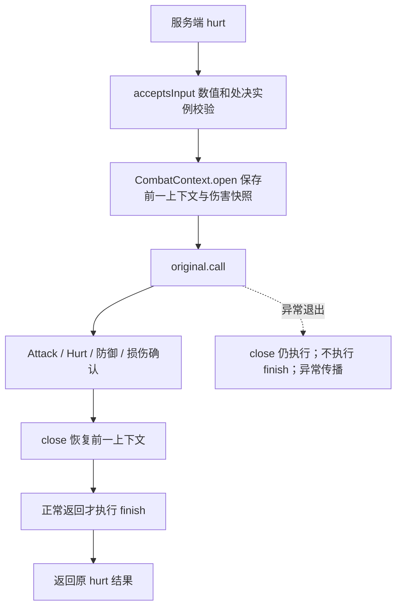

# 伤害确认与重放

职责及来源矩阵见[战斗结算](../模块/战斗结算.md)。

## 建立作用域与正常收尾

[LivingCombatMixin](../../../../src/main/java/com/thelongtravail/mixin/LivingCombatMixin.java) 跳过客户端和玩家；[PlayerCombatMixin](../../../../src/main/java/com/thelongtravail/mixin/PlayerCombatMixin.java) 处理服务端玩家。两者包装 hurt，先 acceptsInput，再 open，try-with-resources 内调用 original。

close 只释放/恢复 CURRENT，不等于 finish。finish 在本次作用域关闭后运行，可能已经恢复外层上下文；不能把新伤害后的副作用挪进 finally。finish 自己抛异常也会传播，且之前副作用不回滚。

## 桥接节点

| 节点 | TLT入口 | 责任 |
|---|---|---|
| Forge onPlayerAttack/onLivingAttack | FluidErosionUnavoidableMixin → prepareAttack | 资格、免疫及部分受击尝试；玩家分流避免重复处理 |
| Forge onLivingHurt | prepareHurt → 原钩子 → finishHurt | 保护策略、内部受伤倍率、单次必杀 |
| getDamageAfterMagicAbsorb 返回 | DamageReplayMixin → beforeAbsorption | 本模组输出/减伤、见切、霸主；普通伤害也走此桥接 |
| 原版实际 setAbsorptionAmount / setHealth 调用 | LivingCombatMixin / PlayerCombatMixin | 取前后实际值记录损失；不是全局监听任意 setHealth |
| Forge onLivingDamage | finishDamage | 最终值过滤与保护/取消处理，不重新跑霸主阈值 |
| 原 hurt 正常结束 | CombatContext.finish | 依来源规则反馈、追加、治疗和反击 |

依据：[ForgeHooks桥接](../../../../src/main/java/com/thelongtravail/mixin/FluidErosionUnavoidableMixin.java)、[防御桥接](../../../../src/main/java/com/thelongtravail/mixin/DamageReplayMixin.java)、[上下文实现](../../../../src/main/java/com/thelongtravail/helper/CombatContext.java)。事件 post 的取消返回值会传入 observeCancellation，三属性反击取消与流体保护模式分别处理，不能只看最终数值。

## 确认和防重复

recordHealthLoss/recordAbsorptionLoss 在实际写入后比较值；有效损失触发 confirmDamage。damageConfirmed 防止一次调用因多个记录点重复分发；replay 则只标记 Frame.confirmed，跳过普通 confirmed 链。堂吉诃德追加、见切反击、洛伦兹幻想追加也有独立提前返回；处决期间的确认还有额外活动状态限制。

已有发生的吸收消耗不因最终事件取消而自动恢复。finishDamage 在最终值归零时结合 attributeDamage.zeroed 和 damageConfirmed 决定是否取消反击，不能将“最后普通生命未变”直接解释为“此前没有任何损伤”。

## 见切反击

AttributeDamage.defend 扣减见切并记录待反击量，再比较霸主阈值；finish 在未取消且待反击量为正时调用 InsightRetaliation.hit。后者使用专有 Source 子类区分普通铁砧，临时设置 CHAIN，finally 清理。反击仍进入目标 hurt；标签、Source 类型、荆棘、蔷薇和同步 CHAIN 共同阻止本模组反击往返递归。

反击不是无条件成功：伤害冷却、目标防御、双方存活/移除/世界和伤害权限均可能影响结果。反击不能恢复已经死亡的防守者，是否存活在实际 hit 时判断。

## 已结算伤害重放

[DamageReplay](../../../../src/main/java/com/thelongtravail/combat/DamageReplay.java) 当前由 EverlastingFlower 策略提交任务；它不等同于所有追加伤害的通用入口。

1. enqueue 拒绝非正/非有限数值、跨世界或无效目标，服务器队列上限4096；容量不足直接丢弃并计诊断，不无限排队。
2. readyTick 为下一服务器 tick。ServerTick END 每次最多取队首一个已到期任务；无效任务也占用本次处理，不保证每个任务恰好下一tick执行。
3. 复核弱引用、存活、世界以及 UUID 对应对象仍为原实例，执行策略 valid 和相关玩家伤害权限检查。
4. 重建 DamageSource，建立 Frame；保存 invulnerableTime/lastHurt，暂时清受伤冷却后调用 target.hurt。
5. CombatContext.claim 仅接受同目标和同来源实例一次。DamageReplayMixin 跳过重放的护甲、魔法和盾牌重复处理；settled 跳过必杀/见切，当前霸主仍有效。
6. finally 恢复旧冷却字段和前一 Frame。仅未取消、实际确认且目标存活、策略再次有效并允许续链时，重新 enqueue。

cancel 以攻击者对象与 Policy 对象身份删除待执行任务，并标记当前匹配 Frame 不续链；不会撤销已经发生的伤害。hurt 抛异常时现场恢复，但不继续入队；队首任务已移除，不做盲目重试。停服清队列，未承诺跨存档恢复。

## 改动检查点

- 入口与阶段：玩家/非玩家分流、Mixin注册、原版/Forge目标及映射。
- 数值与状态：未结算/已结算来源、非有限值、仅黄心损失、霸主相等边界。
- 重入：嵌套来源相同、异常退出、外层冷却恢复、反击链标记。
- 延迟：策略取消、离线/换维度、相同UUID不同实体、队列压力。
- 玩法：不要把普通 confirmed/finish 接入自动扩大到处决、反伤和重放。

[返回项目书](../README.md)

## 逐日与籠釣瓶接入

伤害确认先交给 Kagotsurube.confirmed 和 SunChaser.confirmed，再执行旧机制的特殊来源排除。SunChaser.finish 使用命中快照中的燃烧状态和最大生命值计算追加。SunStrike 跳过本模组攻击增幅与必杀，仍允许凋零累计；它不再次进入无穷花普通成功伤害分派。DamageReplay 恢复受伤冷却时检查 SunChaser.suppressed，避免覆盖仍有效的抑制；队列策略与每刻处理量不变。女仆共享该链，主体解析见 [女仆联动](../../sun-blade-maid-integration-plan.md)。
