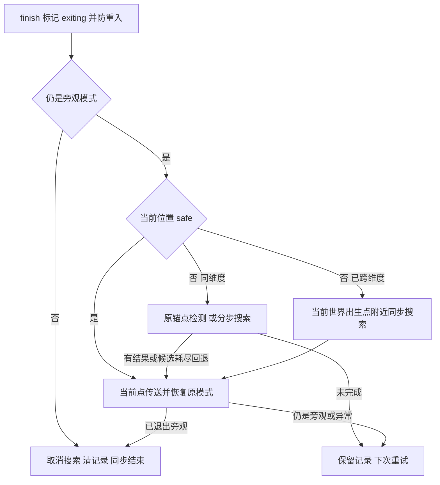

# 入梦与梦醒落点

无垠物品逍遥游（free_and_easy_wandering）的入梦/退出链路。

## 入口与职责

| 源码 | 职责 |
|---|---|
| [BoundlessAccessoryItem(true)](../../../../src/main/java/com/thelongtravail/item/BoundlessAccessoryItem.java)、[BoundlessEquipment](../../../../src/main/java/com/thelongtravail/boundless/BoundlessEquipment.java) | 佩戴规则与运行时装备查询；dream 分支不要求日记或指定槽位，但排除 cosmetic，canEquip 另要求玩家与唯一性 |
| [BoundlessClient](../../../../src/main/java/com/thelongtravail/client/BoundlessClient.java)、[BoundlessPacket.Cast](../../../../src/main/java/com/thelongtravail/network/BoundlessPacket.java) | 按键请求、客户端显示；服务端连接/实例校验见 [协议表](网络协议与状态生命周期.md)，客户端不决定落点 |
| [DreamState](../../../../src/main/java/com/thelongtravail/boundless/DreamState.java) | 入梦记录、模式切换、时间与冷却、安全判定、退出/恢复协调 |
| [DreamLandingSearch](../../../../src/main/java/com/thelongtravail/boundless/DreamLandingSearch.java) | 同维度退出的分步候选搜索、区块票据和异步请求 |
| [BoundlessEvents](../../../../src/main/java/com/thelongtravail/boundless/BoundlessEvents.java) | START 玩家更新、END 搜索推进、登录/退出/跨维度/克隆/停服处理 |

装备查询是资格基础，DreamState 是玩法协调层，Search 是专用落点服务；Search 直接依赖 DreamState.safe 和玩家记录，不是无条件适用于全部传送的通用工具。

## 入梦与计时

cast 先拒绝时停玩家；已有 RECORD 时请求提前梦醒。新入梦要求存活、非旁观、真实佩戴逍遥游且只打开玩家自身库存菜单，再检查冷却。先写原模式、维度、坐标和剩余时间，再尝试切旁观；setGameMode 返回 false 时删除记录并提示失败，不设置新冷却。成功后下坐骑、设置冷却并同步 active。

| 数据 | 所有者 / 生命周期 |
|---|---|
| LongTravailDream | 玩家 persistentData；mode、dimension、xyz、left；退出过程追加 exiting、retryDelay、notifyWake |
| LongTravailDreamCooldown | 玩家 persistentData；入梦成功立即设置，梦中也可递减，离线及时停玩家不走正常递减 |
| FINISHING | 按 ServerPlayer 对象身份防重入的内存集合，finish 的 finally 移除 |
| 搜索、候选、pins、future | 内存；绑定玩家对象、ServerLevel、RECORD 对象引用和锚点，不保存为独立 SavedData |
| dreaming / cooldown | 客户端提示快照；退出清理，不是服务端资格来源 |

START 阶段对未冻结玩家执行 DreamState.tick，先递减冷却，再更新梦境。冷却归零同步；另每 20 个服务器 tick 发送梦境状态。剩余时间到期、失去装备、死亡、外部切离旁观或维度变化会进入 finish；最后 100 tick 按秒提示。exiting 状态优先处理重试，不继续正常倒计时。

## 退出分支

finish 先置 exiting，合并 notifyWake；重入直接返回。仍旁观时重置摄像机到自己，优先保留当前安全位置。传送始终使用当前 ServerLevel，保持当前朝向，清 fallDistance，再恢复记录中的原模式。若外部已切离旁观，只撤销托管记录，不覆盖外部选定模式，也不强制回原世界。

模式恢复后仍旁观则保留记录；RuntimeException 也保留记录，首次尝试记录警告。一般设置 20 tick 重试延迟，等待同维度搜索结果时设为 1。成功清 RECORD、取消搜索并同步结束；这是分步恢复，不是模式、传送和存档的原子事务。

## safe 的含义与回退限制

safe 检查站立体积覆盖区块已加载、脚点在世界边界内、建造高度、当前位置无碰撞，以及向下最多约 5 格能碰到支撑。再遍历站立体积到支撑面的路径，拒绝流体、火标签、细雪、凋零玫瑰、岩浆块、仙人掌、甜浆果丛和点燃营火。它不是对所有模组危险、保护区或后续世界变化的通用安全保证。

同维度原锚点不安全时，Search 先准备锚点区块并检测原点，再从附近格点按距离优先队列扩展六邻接，半径 16；距离相同时按 z/x/y 排序。找到非耗尽结果后，result 会再调用 safe，若环境改变则继续搜索。**候选耗尽时返回原锚点，并跳过这次结果安全复核**。

跨维度使用当前世界共享出生点作为 anchor，依次检测 anchor、near(radius=8、垂直±8) 和 surface(radius=16)，失败后还有出生点回退分支，最终可直接使用 anchor。near 显式 getChunk，surface 查询高度；这条路径是同步的，不享有同维度 Search 的分步预算，也不回到原维度。

## 搜索调度、票据与迟到结果

Search.valid 要求 RECORD 仍是同一个 CompoundTag 对象、玩家仍旁观且未移除、世界对象不变。它不把 UUID 相同的新玩家对象视作原任务。取消移除 SEARCHES/ORDER 并释放全部 pins，迟到请求完成仅在仍 active 时处理，不重新建立已取消搜索。

每次服务器 END 搜索共享最多 2048 步和 2 ms 软期限，每轮单任务最多 32 步；单次 safe/外部调用不被抢占。区块请求是 FULL、带 region ticket，每服务器 tick 至多新发一个；有一个 inFlight，允许另保留一个失效 retired，共享 future 不主动取消。若 retired 已占位，另一个失效未完成请求可继续占 inFlight，不能无限新建。

只有 future.isDone 后才 join，结果失败或步骤异常将该搜索延后 20 tick；异常不等于候选耗尽。搜索获得结果后保留记录/pins 直到退出成功或取消。clear 释放票据并清集合/请求引用，但不等同取消底层共享区块任务。没有独立总超时保证，慢请求可延长退出等待。

## 生命周期与资源维护

| 事件 | 实际处理 |
|---|---|
| 登录 | 尝试 finish 恢复残留记录；不是自动续玩旧梦境 |
| 离线 | 先 finish，再取消该玩家搜索；失败恢复记录可继续存在，离线不推进计时 |
| 跨维度 | 当前世界执行 finish，按跨维度落点分支处理 |
| Clone | 显式复制梦境冷却及星之声计时键；此处不复制 Dream RECORD |
| 重生 | 同步新实例当前 active 状态 |
| Stopping / Stopped | Stopping 逐玩家尝试 finish 后清搜索；Stopped 再清搜索。未完成恢复不因清运行队列而自动成功 |

配置定义在 [BoundlessItemsConfig](../../../../src/main/java/com/thelongtravail/config/BoundlessItemsConfig.java)，归入 aspects/boundless.toml：dream.duration 默认 10 秒，dream.cooldown 默认 60 秒，均经 ticks 转换。已开始的 left/冷却是记录值，热重载不重建现有梦境计时。

展示维护源为 [boundless 中文分组](../../../../src/main/lang/zh_cn/aspects/boundless.json)，模型为 [free_and_easy_wandering.json](../../../../src/main/resources/assets/the_long_travail/models/item/free_and_easy_wandering.json)，纹理为 [free_and_easy_wandering.png](../../../../src/main/resources/assets/the_long_travail/textures/item/free_and_easy_wandering.png)。

## 验证范围

[返回六主题地图](../模块/六主题玩法.md) · [返回项目书](../README.md)
