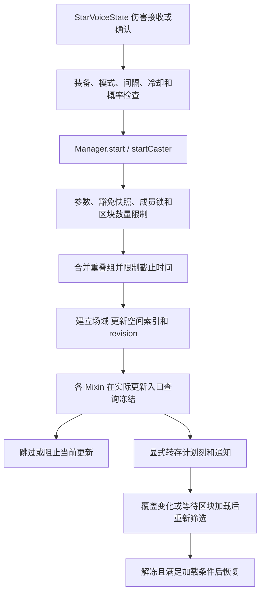

# 冻结与恢复

核对日期：2026-10-24。入口、职责和源码链接见 [时停与恢复](../模块/时停与恢复.md)。本章描述实际控制流，未执行客户端或整合包验收。

## 从玩法到场域

StarVoiceState 的概率判定前已写入本次判定间隔，因此创建场域失败不等于这次判定没有消耗间隔。Manager 会验证释放实体所属世界、中心与半径、持续时间和 allies，再清理到期场域、检查组成员锁以及每区块场域数量限制。创建成功后更新组冷却状态、重建索引并发出提示。

公开 TimeStopApi 仅查询；调试命令与女仆适配也会进入 Manager，但其完整玩法前置判定留在对应章节核对，不能直接等同玩家 StarVoiceState 路径。

## 一个服务器刻内的执行位置

BoundlessEvents 在 ServerTickEvent 的 START 和 END 都遍历世界，先 `Manager.tick`，再 `FrozenBlockEvents.tick`。Manager 先 expire，再处理 FrozenBlockTasks；只有 END 允许同步，且 dirty 或 gameTime 为 10 的倍数时才请求发送。TimeStopSync 还会比较每位玩家的上次快照，相同内容不重发。

所以任务恢复不是“每 tick 恰好一次”或“每 tick 只恢复一个”。当前实现没有恢复批次配额，满足条件的候选可在一次调用中集中释放。此处只说明调度事实，不推断实际 TPS。

实体冻结时由 FrozenEntityClock 保证同一实体同一服务器 tick 只处理一次补偿；正常生物更新也标记时间戳，避免先正常更新、后冻结又重复递减受伤计时。

## 转存与释放规则

FrozenBlockTasks 除了截获新调度，还扫描场域覆盖区块的既有计划刻容器；用容器版本避免无变化的重复扫描。FrozenCoverage 按区块内场域 ID 集合检测变化，因此同一区块仍被覆盖但某一场域消失，也会触发相关候选重查。

| 类型 | 去重/更新键 | 恢复语义 |
|---|---|---|
| 方块或流体计划刻 | fluid、类型 ID、位置；已有记录保留首条 | 目标不冻结且已加载后，按当前 gameTime 加 remaining 重新调度，保留 priority/order |
| 流体边界 | from、to；保留首条 | 两端均不冻结且源位置已加载后，读取当前源流体并按其 tickDelay 调度；不重放旧流体状态 |
| 形状更新 | 目标位置、方向；更新内容但保留队列次序 | 目标解冻且已加载，恢复时读取 source 当前方块状态 |
| 邻居通知 | 目标位置、来源位置、block ID | 目标解冻且已加载；区分带 BlockState 与不带状态的调用重载 |
| 方块事件 | BlockEventData，另合并 gates | 事件位置与全部 gates 解冻、事件位置已加载后重新提交 blockEvent |

FrozenBlockTasks 内释放顺序为计划刻 → 流体边界 → 形状 → 邻居通知；随后事件层处理方块事件。每类队列按原插入次序筛选就绪任务，未就绪项不阻塞后面的就绪项；不存在跨类别统一 FIFO。

等待区块通过 hasChunkAt 检查并记录，加载后重查相关候选。这是显式就绪检查；不能据此宣称所有恢复回调和后续原版逻辑绝不会读取其他区块。

## 异常与持久化

IndexedFrozenQueue 将就绪任务先组成批次再调用外部逻辑：

- 筛选就绪条件时异常：外部更新尚未执行，已取出的记录全部恢复，并将候选重新标记待检查。
- 执行某一任务时异常：当前任务可能已有副作用，不自动重试；只恢复尚未开始的记录，并重新抛出异常。
- 恢复记录若与回调期间新加入的同键任务冲突，计划刻/流体边界保留旧记录，默认队列采用较新的内容；恢复后的顺序沿用旧记录次序。

这不是事务回滚，也不是保证每个任务最终成功的重试器。改变异常策略需要另行讨论行为影响，不能当作纯文档整理或性能优化顺带修改。

正常停止时，BoundlessEvents 调用 Manager.stopping：清除场域 → 重建覆盖 → 结算失去全部场域的组 → 尝试释放 FrozenBlockTasks；之后再处理 FrozenBlockEvents。ServerStopped 才清空 Manager 和同步缓存。未满足加载条件的任务仍可留在 SavedData；启动后场域不重建，已保存任务按各自条件重新释放。

玩家退出没有直接撤销其场域；换维度刷新玩家接收视图，也不代表原世界场域消失。组冷却在原组全部场域到期后结算；离线待交付表只在本进程内存中存在，不能当作独立的持久化存档。

[返回项目书](../README.md)
