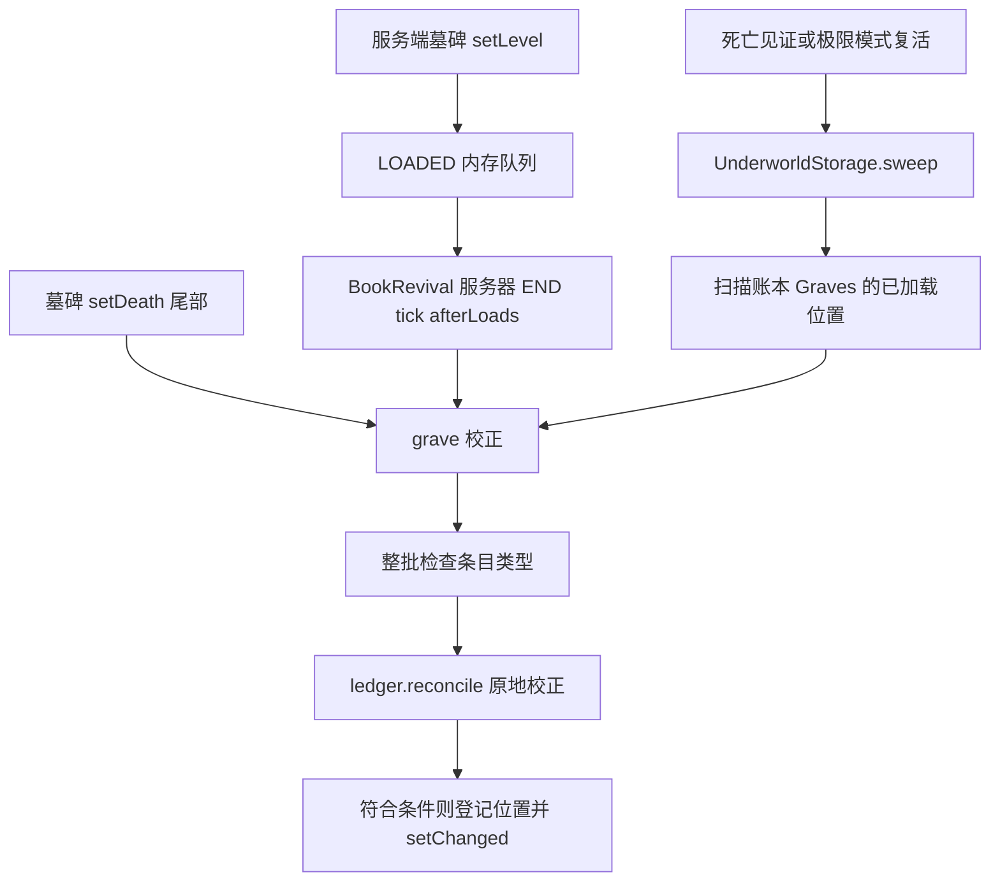

# 墓碑校正与账本生命周期

第三方库存引用及完整死亡流程需单独验证。本章补充 [复活与终结](../模块/复活与终结.md)，兼容契约的首要说明仍在 [可选兼容](../../optional-compat.md)。

## 基础与适配的分工

| 入口 | 责任 |
|---|---|
| [UnderworldLedger](../../../../src/main/java/com/thelongtravail/underworld/UnderworldLedger.java) | 主世界 SavedData，保存消耗/见证事实、死亡记录和墓碑位置索引；负责物品/NBT 校正 |
| [UnderworldStorage](../../../../src/main/java/com/thelongtravail/underworld/UnderworldStorage.java) | 玩家、掉落物和墓碑校正协调；墓碑方法委托适配层 |
| [GravestoneStorage](../../../../src/main/java/com/thelongtravail/compat/gravestone/GravestoneStorage.java) | 待加载队列、墓碑库存校正、位置索引扫描 |
| [GravestoneAccess](../../../../src/main/java/com/thelongtravail/compat/gravestone/GravestoneAccess.java) | 反射读取 Death 和物品列表，缓存方法并检查签名 |
| [BookBlockEntityMixin](../../../../src/main/java/com/thelongtravail/compat/mixin/gravestone/BookBlockEntityMixin.java) | BlockEntity.setLevel 尾部将服务端精确墓碑类实例加入加载队列 |
| [BookGravestoneMixin](../../../../src/main/java/com/thelongtravail/compat/mixin/gravestone/BookGravestoneMixin.java) | 墓碑 setDeath 完整签名的尾部直接调用校正 |

账本掌握“某身份已消耗/已有见证”的事实，墓碑只是一处待同步的存储。Graves 保存维度和位置，不是物品副本，也不是与墓碑库存绑定的事务日志。

## 装配契约

[OptionalCompatPlugin](../../../../src/main/java/com/thelongtravail/compat/OptionalCompatPlugin.java) 根据 gravestone 是否安装及 [OptionalCompatChecks](../../../../src/main/java/com/thelongtravail/compat/OptionalCompatChecks.java) 的字节码契约决定两个 Mixin 是否应用。要求 GraveStoneTileEntity.getDeath、setDeath 和 Death.getAllItems 的完整签名及公共实例方法资格，setDeath 必须有可注入的方法体。运行时 GravestoneAccess 还会核对反射方法签名与访问能力。

加载识别与索引扫描使用完整类名精确相等，不自动支持任意墓碑模组或子类。getAllItems 必须返回可遍历结果，所有条目先整批验证为 ItemStack，再开始校正。签名正确不证明返回的 ItemStack 是库存中的原引用；当前适配依赖原地修改这些引用，再 setChanged 保存，没有独立的库存写回 API。该语义仍需第三方实际版本验证。

## 触发与处理流程

afterLoads 逐条 poll，再检查实例未移除、level 非空且属于当前服务器。此队列没有去重或每 tick 数量/时间预算；一次调用会持续处理到队列为空或适配关闭。不能把 UnderworldMaintenance 的玩家分步预算套用到墓碑处理。

grave 在服务端且适配启用时读取物品。Death 为空或读取结果为空直接返回。对每件物品，先检查顶层 tag 是否有 TravailBookId，再调用 ledger.reconcile。任意条目满足顶层身份条件就将 `维度ID|BlockPos.asLong()` 加入 Graves，新增时标记账本 dirty；正常完成后标记方块实体 setChanged。

reconcile 将已消耗身份的顶层物品数量置零，并递归校正 NBT 中的死者之书和对应旅程轮次的见证，深度上限 64。**能递归校正不等于会递归建立墓碑索引**：仅嵌套物品含书本身份、或仅含日记的墓碑，不因这些内容自动进入 Graves。加载和 setDeath 仍可直接校正它们。

[BookRevival](../../../../src/main/java/com/thelongtravail/underworld/BookRevival.java) 在符合条件的死亡完成后登记见证并 sweep；极限模式复活后登记书本消耗并 sweep。sweep 先处理在线玩家和已索引掉落物，再处理墓碑。玩家校正包含物品栏、末影箱和 Curios，清理已被账本消耗的书本身份。当前没有独立的每隔固定时间全量扫描墓碑流程；END tick 的 afterLoads 只是处理新入队实例。

## 索引与异常生命周期

| 场景 | 当前实现 | 保留与恢复边界 |
|---|---|---|
| 维度不存在或位置未加载 | sweep 跳过，不主动加载区块 | 保留 Graves，等待后续加载或再次 sweep |
| 已加载位置不再是精确墓碑类 | 移除位置索引并标记 dirty | 不删除账本消耗/见证事实 |
| 墓碑物品不再含顶层书本身份 | grave 不新增索引 | 已有索引不会因此自动移除 |
| 签名/访问/链接不兼容 | GravestoneAccess 停用适配 | 账本保留；afterLoads 见停用状态时清队列 |
| 返回列表含非 ItemStack | 整批验证阶段停用并立即清队列 | 本次尚未开始物品校正 |
| getDeath/getAllItems 方法本体抛异常 | 包装为 IllegalStateException 向上传播 | 不按签名不兼容吞掉，也没有单项自动重试 |
| 遍历或校正中其他异常 | finally 只记录耗时；异常继续传播 | 已完成修改没有整体回滚；setChanged 和索引登记可能尚未执行 |
| 停服 | BookRevival.stopped 清内存加载队列 | SavedData 按普通保存生命周期保留 |

afterLoads 在调用 grave 前已经 poll 当前条目，异常不会把它重新入队；剩余条目仍留在队列，但本次调用被异常打断。后续 tick 是否继续由上层异常处理决定。已登记位置可能在后续 sweep 再遇到，未登记实例则需新的 setLevel/setDeath 等触发。

[OptionalCompatState](../../../../src/main/java/com/thelongtravail/compat/OptionalCompatState.java) 的 Gate 一旦 DISABLED，本次启动不再自动启用；修复版本并重启后重新检查。停用不会撤销之前已经完成的库存校正，也不会删除 Graves。

Graves 加载时验证维度 ID 和 long 坐标格式，损坏记录放入 QuarantinedLedger，不参与扫描；保存时同时保留有效索引和隔离记录。索引与物品/世界文件没有跨文件原子提交保证。

## 维护与验收

新增墓碑适配应明确方法签名、返回引用或副本、写回/dirty 契约、加载事件、索引条件与失败重试责任，不能只提供一个 NBT 遍历器。异常重试策略与索引范围由适配层管理。

[返回项目书](../README.md)
