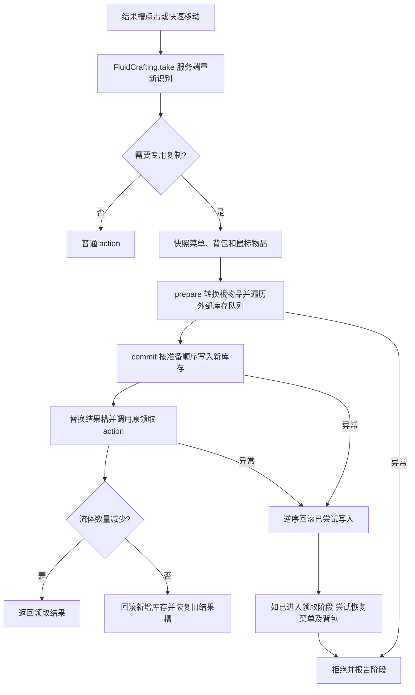

# 复制预览与领取

核对日期：2026-10-24。源码分工与路径见 [外部库存复制](../模块/外部库存复制.md)。事务分析限于 TLT 流程；第三方回调和断电恢复不具备已验证的完整事务保证。

## 预览与真实准备分开

PerfectFluidRecipe.matches 检查两个非空槽位、目标保护规则、菜单支持及黑名单；异常记录后不匹配。assemble 通过 PerfectFluidCopies.copy 序列化目标，再调用 reserveIds，在副本上分配身份和净化，异常则给空预览。

预览图 `preview=true`：会改写已识别 UUID，但不排队读取它们指向的外部库存，也不提交存储写入。因此嵌套背包中的 capturedMobs 等限制可能直到领取时才被发现。内嵌 AE2/物质球数据仍经过专用转换。预览 UUID 不是最终领取 UUID；真实准备建立另一张图。

## 领取入口与重入

普通点击桥接只包装结果槽，并排除 QUICK_MOVE、CLONE、QUICK_CRAFT、PICKUP_ALL；QUICK_MOVE 由 quickMoveStack 单独包装。take 再检查服务端玩家、精确菜单类型及 ACTIVE 标记。ThreadLocal 防止同线程嵌套包装重复准备；finally 移除标记，它不是跨线程事务锁。

服务端重新从配方管理器识别当前配方。若旧结果仍在但配方已失配，网格里又存在完美流体，则拒绝，避免领取过期预览。只有本配方且 hasReferences 为真才走完整准备流程；AE2 和物质球也被此识别纳入，即使其内容不需要外部 UUID 写入。

## 准备与提交顺序

1. 保存全部菜单槽、玩家背包和鼠标携带物品；记录流体槽领取前数量。
2. `FluidCopyGraph.prepare` 以单件源物品建立根副本。transform 先处理保护项，再分流物质球、AE2 和 UUID 引用。
3. UUID 首次出现时先分配映射，再加入 pending；按队列顺序准备背包、统一盘或 RS 内容。适配器递归发现的新引用继续进入同一图。
4. prepare 返回非空 output 和待提交 Write 列表。commit 在调用每个 write.commit 前就将它加入 attempted，使“写入一半才抛错”的当前项也进入回滚范围。
5. 写入完成后把真实 output 放进结果槽，再执行原版领取。以流体槽数量是否改变判断本次是否消耗；未消耗则回滚新库存并恢复原结果槽。

prepare 与 commit 没有重新校验整个外部源库存版本的通用机制；这里依赖同步调用和各适配接口，不应改写成并发环境中的隔离事务保证。

## 失败时恢复什么

Prepared.rollback 按 attempted 的逆序调用所有 rollback，单项异常仍继续尝试其他项，最后汇总异常。回滚针对本次新身份：背包删除新库存，RS 删除新盘，统一盘删除新代理、Entry 和新 UUID 目录；不以清空源库存作为补救。

FluidCrafting 捕获 Exception。若已经进入领取阶段，逐个尝试恢复非结果槽、玩家背包，最后恢复结果槽和鼠标物品；单个槽位恢复失败会附加到原异常，继续恢复其他项。通知失败和广播失败也汇总到诊断。普通配方 action 的异常在该专用 try 之外，继续向外传递。

不能将上述行为理解为任何失败都完全回滚：外部接口的副作用、恢复回调异常、Error、进程崩溃，以及跨多个存档文件的落盘顺序不在完整原子性保证内。统一盘单个 rollback 的后续清理也可能因前序删除抛错而未执行；复制图继续其他 Write 不等于这个适配器内部每一步都完成。

## 定位问题

按 identification → snapshot → preparation → commit → collection 的阶段定位。能预览但领不到，先看 preparation 的外部内容与格式限制；出现残留新库存时再核对 commit/rollback 诊断和新 UUID，而不是修改原件身份。新菜单接入必须证明领取与材料消耗都被包装，不能仅让 matches 返回 true。

[返回项目书](../README.md)
