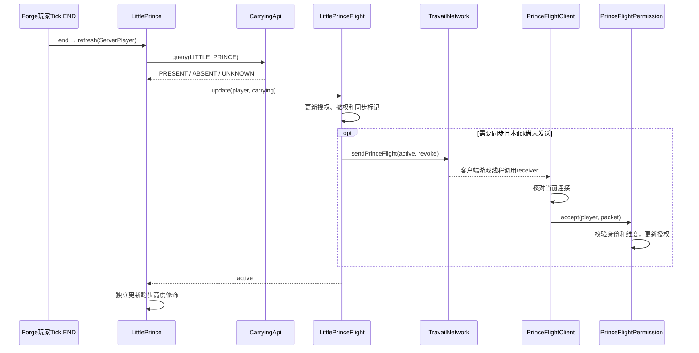

# 小王子飞行：从共享携带查询到两端授权

核对日期：2026-10-24。状态：源码链路已读；本轮未执行服务端、客户端或整合包测试。本章描述飞行与跨步，不覆盖小王子的其他获取和物品机制。

## 职责及基础与扩展

| 角色 | 代码入口 | 职责 |
|---|---|---|
| 共享查询 | [CarryingApi](../../../../src/main/java/com/thelongtravail/api/CarryingApi.java)：query、registerProvider | 按配置查询背包/装备/末影箱/Curios/外部来源，返回三态 |
| 玩法协调 | [LittlePrince](../../../../src/main/java/com/thelongtravail/boundless/LittlePrince.java)：end、refresh | 玩家 Tick END 查询携带、刷新授权；另行维护跨步属性 |
| 服务端状态机 | [LittlePrinceFlight](../../../../src/main/java/com/thelongtravail/boundless/LittlePrinceFlight.java)：update | 维护 mayfly、撤权及同步节奏 |
| 协议与调度 | [TravailNetwork](../../../../src/main/java/com/thelongtravail/network/TravailNetwork.java)：register、sendPrinceFlight；[PrinceFlightPacket](../../../../src/main/java/com/thelongtravail/network/PrinceFlightPacket.java) | 单向服务端至客户端授权；接收任务进入游戏线程 |
| 客户端绑定 | [TravailClientEvents](../../../../src/main/java/com/thelongtravail/client/TravailClientEvents.java) | 初始化 receiver 为 PrinceFlightClient::receive |
| 连接与生命周期 | [PrinceFlightClient](../../../../src/main/java/com/thelongtravail/client/PrinceFlightClient.java)：receive、tick、logout | 连接身份核对、逐 tick 维护、离线清理 |
| 客户端状态机 | [PrinceFlightPermission](../../../../src/main/java/com/thelongtravail/boundless/PrinceFlightPermission.java)：accept、tick、clear | 校验实体 ID/UUID/维度，维护当前玩家授权 |

CarryingApi 是共享能力，小王子是它的使用者；同一查询机制还被 RainState（駅）和 BabelCarrying（巴别塔）使用。CarryingApi.allowed 自身包含这些物品的配置特例，因此它不是完全与玩法隔离的底层库。

## 运行流程

箭头表示本场景中的运行顺序，不表示继承。网络部分省略编解码字段读写。

## 资格与同步规则

- 玩法入口通过携带查询工作，不在此链路要求先佩戴苦旅或拥有无垠见证；携带区域受配置控制。
- PRESENT 授权；ABSENT 撤权；UNKNOWN 仅延续内存中已存在的 active，不凭未知状态首次授权。持久化标记参与旧授权撤销判断，不把 UNKNOWN 变为 PRESENT。
- 死亡或旁观状态不激活；创造/旁观模式由游戏模式管理能力，本机制仍处理旧客户端授权信息。
- 授权写 mayfly，不强制把 flying 设为 true。撤销本机制曾授予的权限时，普通玩家的 mayfly 和 flying 都会清除。
- 授权变化、修复或强制同步时发送；活跃授权每 20 游戏刻重同步。同 tick 合并发送，尚未发送的最终状态留待后续更新处理。
- 消息包括维度、实体 ID、UUID、active 和 revoke；客户端先核对连接，再核对玩家存活与身份/维度。
- 客户端有效授权期间补回 mayfly，不强制起飞。玩家对象变化、死亡或维度变化会清除内部授权；clear 本身不是无条件修改玩家能力。

具体携带契约见 [统一携带 API](../../carrying-api.md)。

## 状态所有权与生命周期

| 状态 | 保存位置 | 更新/清理 |
|---|---|---|
| 携带位置缓存与短期来源信号 | CarryingApi 中按玩家索引的映射 | 查询校验；clone/logout 清理，停服全清；外部信号按游戏时间过期 |
| 服务端 active 和同步标记 | LittlePrinceFlight.STATES | 每次 update；clone/logout forget，停服 clear |
| 旧授权标记 | 玩家 PersistentData：TravailPrinceFlightActive | active 时写入、失效时移除；不代表独占外部飞行权限 |
| 客户端 owner/dimension/active | PrinceFlightPermission | 收包与 tick；玩家实例变化、死亡、换维度或离线清理 |
| 跨步修饰 | STEP UUID 对应的临时属性修饰 | refresh 排除自身旧贡献后重新计算；只处理该来源 |

LittlePrince 的登录、重生与换维度监听调用 resync 标记；实际发送在后续 update。clone/logout 清理旧玩家缓存，停服清理所有缓存。不能把这些监听器误画成每个都立即发送数据包。

## 扩展与修改影响

| 想改什么 | 应检查什么 | 影响范围 |
|---|---|---|
| 支持新的外部携带来源 | Provider、来源开关、异常→UNKNOWN、递归限制 | 小王子、駅、巴别塔及其他外部调用者 |
| 改飞行资格/撤权 | 服务端状态机、客户端状态机、游戏模式、外部授权 | 能否飞行及与其他飞行模组共存 |
| 改消息字段 | 编解码、注册、发送、receiver、连接/身份校验 | 两端协议一致性 |
| 改跨步高度 | LittlePrince.refresh 的自身贡献扣除和配置 | 跨步属性，不应顺带改变飞行状态 |
| 改更新频率 | Tick 阶段、20 tick重同步、同 tick合并 | 授权恢复时延和消息频率 |

当前撤权没有按来源合并其他模组的飞行授权。后续改善必须单独设计和验证；本章记录这一边界，不将它当作已经解决的能力共存机制。

## 验证入口与待验场景

共享仓库的携带契约和源码可直接查阅。作者本地 `tools/prince-flight.init.gradle` 提供隔离服务端入口：`gradlew.bat -I tools/prince-flight.init.gradle runServer`；依赖本机 Java/Gradle 缓存及已有 run/eula.txt，输出在 build/prince-flight-baseline，成功断言检查 flight-result.txt。本地 tools 不保证随仓库提供，因此这里不用会在干净克隆中失效的文件链接。

这只是已核对存在的测试入口，不代表夹具已对当前全部行为完成覆盖。本轮未运行。后续验收应覆盖：首次携带、撤权、UNKNOWN 保留和首次 UNKNOWN、死亡/重登/换维度、旧连接消息、身份不匹配、创造/旁观、同 tick多次更新，以及外部飞行授权共存。客户端表现需要单独实测，隔离服务端 PASS 不替代它。

[返回总体架构](../总体架构.md) · [返回项目书](../README.md)
