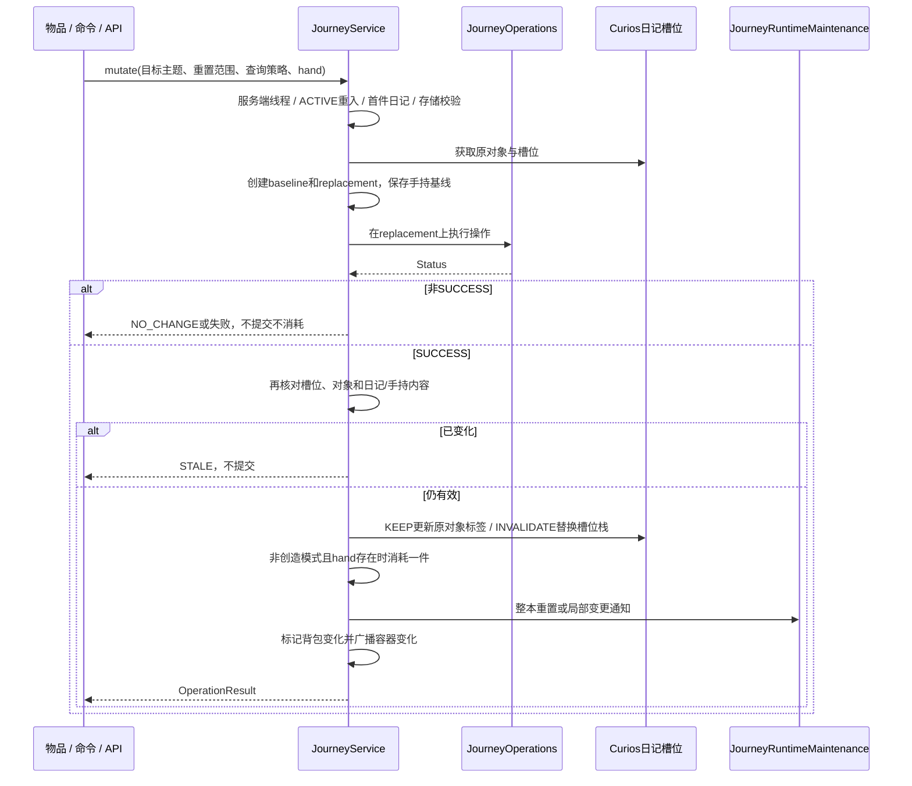

# 旅程修改与探索确认

模块及字段定义见 [旅程与主题状态](../模块/旅程与主题状态.md)。

## 精粹、命令和外部写入

精粹经 AspectEssenceItem.use → JourneyService.essence：根据当前有效见证决定重置主题或随机完成一个剩余条件，使用 INVALIDATE。全修经 RenewalItem → resetJourney。调试命令经 TravailJourneyApi 设置/清除覆盖。外部 API 不自动消耗调用方物品，内部物品入口可传 hand 交由服务消耗。

源码：[JourneyService.mutate](../../../../src/main/java/com/thelongtravail/data/JourneyService.java)、[JourneyOperations](../../../../src/main/java/com/thelongtravail/data/JourneyOperations.java)、[TravailJourneyApi](../../../../src/main/java/com/thelongtravail/api/TravailJourneyApi.java)。

ACTIVE 在 finally 中释放。该流程保护提交前的原数据和消耗条件，但提交后的运行回调没有通用回滚：标签/槽位提交、物品消耗之后若回调抛异常，不能声称前面的副作用被撤销。

## 操作差异

| 操作 | 数据变化 | 查询策略/副作用 |
|---|---|---|
| completeRequirement / completeRandomRequirement | 剩余条目移入完成列表；必要时置 Witnesses；两个修订增加 | 外部入口 INVALIDATE |
| grantWitness | 身份匹配后写见证位、来源；只增 StateRevision，不清空条件 | KEEP；强制恶意仍可使有效状态保持恶意 |
| set/clearOverride | 只改 ForcedWitnesses/ForcedMalices 与 StateRevision | KEEP；真实进度保留 |
| resetAspect | 新主题 Epoch、重新抽取、清除主题覆盖和来源；两个修订增加 | INVALIDATE，局部状态校正 |
| resetJourney | refreshedCopy 重建整本 LongTravail 数据 | INVALIDATE，完整运行清理及玩家摘要发送 |

`changed()` 仅对 SUCCESS 为真；`accepted()` 接受 SUCCESS 和 NO_CHANGE。NO_CHANGE 在副本操作后提前返回，不消耗物品、不发布变化；精粹要求 changed，命令可以接受幂等的 NO_CHANGE。

## 自然到访路径

1. TravailEvents 的服务端 LivingTick 每 20 玩家 tick 调用 JourneyQueries.update；未佩戴日记时也可记录玩家新发现群系。
2. 查询维度、位置、读取时间及 RequirementIdentity；需要时初始化日记和刷新群系/结构目标。
3. JourneySpatial 提供位置匹配候选；当前可确认群系通过 LongTravailData.visitBiome 完成条件；结构通过 JourneyVisits.observe 或后续 tick 中的 complete 确认。
4. LongTravailData.removeRequirement 对所有主题调用 JourneyOperations.complete，因此同一次到访可以完成多个主题。最终将本次两个修订各合并为一次增量。
5. 每段自然更新后调用 JourneyVisits.rebase，将匹配旧身份的待确认项续接到新修订；随后按变更刷新需求缓存。

源码：[JourneyQueries](../../../../src/main/java/com/thelongtravail/data/JourneyQueries.java)、[LongTravailData](../../../../src/main/java/com/thelongtravail/data/LongTravailData.java)、[JourneyVisits](../../../../src/main/java/com/thelongtravail/data/JourneyVisits.java)。

这条路径直接修改日记数据，不走 JourneyService 的手持校验、消耗和 onJourneyChanged 回调；不能把两条路径画成完全相同的事务。自然变化后的其他玩法响应依赖既有 Tick/状态读取与装备同步路径，完整响应时序留待对应主题章节验证。

## 延迟确认与失效

JourneyVisits.Observation 保存发起玩家、世界、位置、目标和 JourneyId/RequirementsRevision。valid 复核玩家存活、连接、世界、当前已装备日记身份及超时。区块请求通过票据和 future 准备，实际完成由服务端 tick 取出处理；并非在任意异步线程直接写日记。

外部 INVALIDATE 操作调用 JourneyQueries.forget（同时 forget 待确认项）以及 WayguideSearch.forget。自然变更使用受控 rebase 保留旧位置观察的续接，两者目的不同。取消观察会释放对应票据，但未完成共享请求仍占在途名额，不能认为 forget 必然中断底层 future。

## 缓存和状态校正

| 变更 | JourneyRuntimeMaintenance 中的处理 |
|---|---|
| INVALIDATE | 清玩家探索查询/待确认与路引搜索 |
| 幽谷有效位切换或该主题重置 | AzraelState.forget |
| 穷遐有效位切换或该主题重置 | CleanseRotation.forget |
| 无垠有效位切换或该主题重置 | AltitudePenalty.forget，并更新额外槽位和高度惩罚 |
| 整本重置 | resetRuntime 清理多个运行缓存、视觉剥夺与僵硬；更新槽位/高度并 sendJourney |

依据：[JourneyRuntimeMaintenance.onJourneyChanged/onDiaryReset](../../../../src/main/java/com/thelongtravail/event/JourneyRuntimeMaintenance.java)。`sendJourney` 仅发送玩家探索计数和揭示位，完整日记同步不能由该包单独完成。

## 接入判断

- 新增外部效果完成条件：走 TravailJourneyApi，不照搬自然探索的 rebase。
- 延迟授予：保存发起时的 AspectJourneyKey；重置后旧键应产生 STALE。
- 增加纯展示字段：先确定是否需要 StateRevision，不能无理由增加 RequirementsRevision 取消探索确认。
- 新增主题运行缓存：明确局部重置、整本重置、死亡、换维度、离线和停服时的失效入口。
- 本章只核对既有实现，没有修改重试、消耗、概率或失败策略。

[返回项目书](../README.md)
