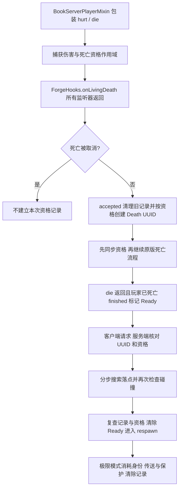

# 死亡确认、复活与终结

模块与源码索引见 [复活与终结](../模块/复活与终结.md)。两条流程共享死亡结果观察，但后续处理不同。

## 死亡确认到苏生

[BookServerPlayerMixin](../../../../src/main/java/com/thelongtravail/mixin/BookServerPlayerMixin.java) 保证 Hit 与 Death 作用域退出恢复。[AzraelDeathMixin](../../../../src/main/java/com/thelongtravail/mixin/AzraelDeathMixin.java) 包装 ForgeHooks.onLivingDeath，在原调用返回后同时通知 AzraelExecution.deathResult 和 BookRevival.accepted，因此不会在其他死亡监听器尚未决定取消前就认定成功。

accepted 对匹配且未取消的死亡先清除旧搜索/记录，随后才判断本次是否合格。记录含玩家、Death、Book、维度、位置、朝向、极限模式和体积。finished 只有在 die 正常返回且玩家不存活时才置 Ready；符合四效果、最终伤害和未见证条件时，向账本记录对应旅程见证并校正物品。

request 要求玩家已死亡、记录 Ready、Death UUID 一致、无重复搜索及账本允许；服务器 END tick 每个搜索执行 step(256)。搜索完成后再次 clear；位置变化导致不可用时重新请求搜索。revive 还检查记录对象仍是当前记录及资格仍有效。

[BookPlayerListMixin](../../../../src/main/java/com/thelongtravail/mixin/BookPlayerListMixin.java) 在这次 RESPAWN 作用域内替换维度和落点，恢复玩家原绑定出生点信息；BookServerPlayerMixin 临时隐藏旧实体绑定点以避免消耗重生锚。复活后更新连接指向的新玩家对象，极限模式记账消耗并扫存储，再传送、设置保护、删除死亡记录和关闭资格。

这不是回滚事务：调用 respawn 前已将 Ready 置为 false，finally 仅移除 RESPAWN 作用域；若重生或后续步骤抛错，代码没有统一恢复 Ready、消耗和所有外部副作用的补偿流程。排查必须定位实际失败阶段，不能直接重发同一请求假设可安全重试。

## 死告天使请求到最终清理

AzraelState 在伤害确认后消耗机会并随机判定，将玩家、目标 UUID、状态对象、是否自我处决和维度入队。服务器 END tick drain 仅处理进入本次 drain 时的队列数量，再核对连接、维度、状态对象、目标存活和是否已移除；AzraelExecution 还核对规则、PvP/关系、锁和重入。

执行阶段按配置进行：

1. 最多 ATTEMPTS 次无穷伤害；每次先记录归属、清除受伤无敌计时，随后检查真实死亡结果。非有限结果修复后停止该轮尝试并进入允许的后续阶段。
2. 若启用 KILL_FALLBACK，以带归属的 generic_kill 和 Float.MAX_VALUE 再尝试。
3. 若启用 DEATH_FALLBACK，记录战斗伤害并调用 FinalExecution.commit。

FinalExecution 要求服务端线程并拒绝重入/已锁目标。先保存底层生命值、锁实例、准备掉落观察并提交生命值为零。死亡尚未开始就失败时会撤锁并恢复旧值；一旦 die 开始，不再恢复实体或重演死亡。

非玩家通过 VanillaExecution 调用原版死亡/移除路径；必要时 ExecutionCleanup 通过存储桥接擦除世界引用、解除乘骑关系、清空回调并复核脱离状态。回调可能重新插入旧实例，notifyRemoval 后会再次核对。完成后发送终结通知、置 terminated、清除 cleanupPending，再处理掉落补偿。

玩家仍调用玩家死亡流程，检查 admitted 和生命值是否确实为零；不进入非玩家 rawDetach。不能把清理非玩家世界索引的方案推广到玩家。

## 失败与后续观察

FinalExecution 在尝试移除前标记 cleanupPending 并注册 ExecutionWatch。清理未完成时 retryCleanup 只重走 terminate，不重新 die。若死亡调用本身异常，会先 abort 掉落补偿并尝试清理，随后仍抛出原异常及附加的清理异常。

ExecutionWatch 在服务端世界 END tick 轮询：轻量检查和周期性深查分开，发现旧实例回填则清理；失败采用退避，直到租约截止。清理完成不意味着所有第三方内部私有引用都已被枚举清空；全部 ExecutionStorage/Mixin 的结构覆盖仍需专项核对。

掉落补偿先置 handled 再解析与生成；即使部分物品生成失败也不整批重试。复活路径又明确排除处决来源，所以不能靠启用苏生去撤销最终处决的实例锁。

## 定位入口

“死亡按钮有资格却不能复活”先检查 Ready、Death UUID、消耗可靠性、搜索状态及重生异常；“显示死亡但仍有实体”检查 acceptedDeath、cleanupPending、terminated 和世界存储引用；“终结没有掉落”检查是否曾观察到实际入世物品、handled、doMobLoot 和补偿日志。不要将这三类报告统一归因为生命值没有归零。

[返回项目书](../README.md)
