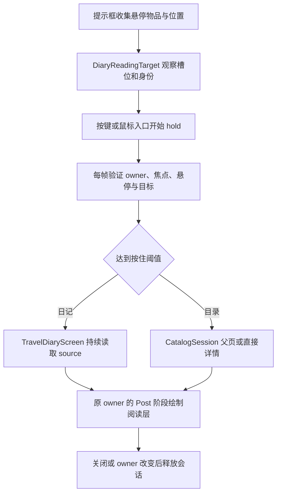

# 界面会话与渲染生命周期

本文连接日记/目录、字体路由和灯笼光照入口，不宣称逐行审计全部布局绘制或全部第三方 renderer。网络快照见 [网络协议与状态生命周期](网络协议与状态生命周期.md)。

## 状态归属与基础能力

| 层次 / 源码 | 归属与使用者 |
|---|---|
| [TravailClientEvents](../../../../src/main/java/com/thelongtravail/client/TravailClientEvents.java) | 保存 owner Screen、日记阅读页、悬停目标、按住进度及已消费按键；协调 Forge 界面事件 |
| [DiaryReadingTarget](../../../../src/main/java/com/thelongtravail/client/DiaryReadingTarget.java) | 将可定位槽位与旅程身份绑定，向阅读页提供当前物品，不是一次复制后永远显示旧物品 |
| [DiaryEntryHold](../../../../src/main/java/com/thelongtravail/client/DiaryEntryHold.java)、[DiaryHoldProgress](../../../../src/main/java/com/thelongtravail/client/DiaryHoldProgress.java) | 共享按住进度与入口归属；不负责界面绘制或服务端授权 |
| [TravelDiaryScreen](../../../../src/main/java/com/thelongtravail/client/TravelDiaryScreen.java) | 当前主题、旅程页、滚动与布局缓存；每次 render 向 source 取物品 |
| [CatalogSession](../../../../src/main/java/com/thelongtravail/client/catalog/CatalogSession.java) | owner、父目录和当前页、缩放及输入消费；同一会话保留父页对象 |
| [CatalogScreen](../../../../src/main/java/com/thelongtravail/client/catalog/CatalogScreen.java)、[CatalogDetailScreen](../../../../src/main/java/com/thelongtravail/client/catalog/CatalogDetailScreen.java) | 父页负责搜索/卡片/滚动；详情保存展示物品副本、段落快照、行布局和来源标志 |
| [CatalogEntries](../../../../src/main/java/com/thelongtravail/client/catalog/CatalogEntries.java) | 条目、类别、别名搜索与说明构造，是目录数据入口 |
| [DiaryText](../../../../src/main/java/com/thelongtravail/client/DiaryText.java)、[DrawScopedCache](../../../../src/main/java/com/thelongtravail/client/DrawScopedCache.java) | 去除材质标记、防止再次路由；按单次绘制缓存 RenderType 包装，不是全局界面状态 |

## 从悬停进入阅读

canRead 要求没有活动目录、悬停属于当前 Screen、观察不超过 250 ms、鼠标与采样位置差各小于 0.5 GUI 单位。聚焦 EditBox 时不开始入口；按住失去窗口焦点或 Screen 不符会重置。每帧时间增量最多计 0.1 秒，阈值 0.5 秒，松开会衰减。DiaryEntryHold 在首次有效输入时锁定入口，两者同时按下优先日记；已有归属后任一入口键仍按住均可继续进度，不在半途切换归属。

DiaryReadingTarget 按物品对象引用寻找 Curios（含 cosmetic）、菜单槽位、玩家库存；记录来源 owner/kind/slot/index 并通过 supplier 重读。日记按 Journey UUID 接受，不按整个 NBT 完全相等；已定位且最初未初始化的日记允许接纳后续初始化身份。其他物品使用 ItemStack.matches。找不到槽位时退为位置和物品匹配的 preview，不能称为已追踪任意第三方容器。

日记 render 发现 source 已不是日记就关闭；旅程 revision 的正常变化可更新内容，原槽位被不同 Journey 替换则不继续读旧物品。目录详情路径不同：CatalogSession.detail 使用 entry.stack() 的标准新物品构造说明，传入的实际 stack 没有用于详情生成；不能把详情当作该实例 NBT 的实时查看器。

## owner、导航与输入消费

两种阅读层都没有把自己的 page 直接设为 Minecraft 当前 Screen，而是保留原 owner，取消其 Render.Pre，在 Render.Post 绘制阅读层。owner 被替换/关闭会退出；目录 END tick 还检查玩家存在和当前 Screen 等于 owner。页面的 isPauseScreen=false 不能独自决定原 owner 是否暂停游戏。

| 操作 | 当前语义 |
|---|---|
| 日记 Esc / 右键 / 关闭按钮 | 关闭阅读层；方向及翻页键滚动，Backspace 不导航 |
| 目录父页 Esc / 右键 / 关闭按钮 | 退出整个目录会话 |
| 从父页打开的详情 Esc / 右键 | 返回保留的父页，并收起搜索展开状态 |
| 直接打开的详情 Esc / 右键 | 退出会话；没有隐含父页 |
| 详情底部返回 | 调用 session.back，必要时创建父页 |
| 详情关闭按钮 | 始终退出会话 |
| 父页搜索 Backspace | EditBox 编辑；详情 Backspace 不导航 |

日记通过 heldKeys 判断首次按下，阅读中只在 firstPress 转交按键；目录仅抑制 Esc 自动重复，其余重复键可转交，便于连续删字/滚动。两者记录 consumedKeys/consumedButtons，关闭后仍可吞掉对应释放，避免把半次输入交给原界面。Screen.Closing 清输入集合；目录失焦清已消费集合。目录活动时日记入口 canRead 返回 false，键盘处理也让位于目录。

目录布局计算虚拟页面尺寸与 scale；鼠标位置和拖动增量除以 scale，裁剪坐标乘回 scale。新增命中区必须使用对应坐标空间，不能直接混用屏幕像素、GUI 单位和页面单位。

## 绘制次序与状态恢复

日记按背景遮罩、书签/书本、身份与页签、正文、关闭控件、悬停提示绘制。正文裁剪后逐行绘制，再关闭裁剪并画滚动条。布局键包括主题、见证/揭示、初始化、群系数、配置 revision、资源 generation、Language 和字体行高，内容另核对条件身份和状态 revision。

目录详情在 init 时将构造时段落快照分行，尺寸变化可重新排版，但不是每帧重新生成玩法说明。正文绘制跳过 alpha<4 的行，避免 Font 将极小 alpha 当作未指定透明度。[CatalogFrame.fadeEdges](../../../../src/main/java/com/thelongtravail/client/catalog/CatalogFrame.java) 在渐变覆盖前后 flush，使用 guiOverlay，使覆盖发生在此前正文提交之后。

| 状态 | 已有恢复措施 | 限制 |
|---|---|---|
| 阅读层外部 pose | 日记事件层与 CatalogSession 都在 finally 中 popPose | 只负责自己的一个栈层，不会自动清空内部泄漏层 |
| renderingReading 标记 | 日记事件层 finally 置 false | [GuiGraphicsTooltipMixin](../../../../src/main/java/com/thelongtravail/mixin/GuiGraphicsTooltipMixin.java) 据此屏蔽背景提示框，而允许阅读层内部提示 |
| 页面内部 pose/scissor | 正常路径成对 push/pop、enable/disable | 多处没有局部 finally；不能承诺内部绘制异常时仍完全恢复 |
| 日记纹理颜色/混合 | 正常路径恢复白色、disableBlend | 不是保存任意进入状态并原样还原的通用事务 |
| 字体 RenderType | 包装类型调用原 setup，clear 委托原 clearRenderState | 依赖 RenderType/缓冲提交生命周期，不是每次 draw 结束手工恢复旧 Shader |

本次记录这些限制，没有顺带修改异常策略或绘制顺序。

## 字体标记 → 材质 → Shader

[ThemeTooltipMixin](../../../../src/main/java/com/thelongtravail/mixin/ThemeTooltipMixin.java) 在 ItemStack.getTooltipLines 返回后调用 ThemeTooltips.finish；物品名称、主题标题及 DiaryDialogue 等文本通过 Style.insertion 附材质标记。[DiaryFontMixin](../../../../src/main/java/com/thelongtravail/mixin/DiaryFontMixin.java) 以 priority 3000 拦截 Component 和 FormattedCharSequence 两种 drawInBatch。

[DiaryFontEffects.material](../../../../src/main/java/com/thelongtravail/client/DiaryFontEffects.java) 忽略空白，要求非空白字符能归为同一材质；混杂普通字符或不同材质时返回 -1，走原绘制。ThreadLocal probe 有 busy 防重入。DiaryText.Unmarked 和清除 insertion 的绘制序列阻止再次进入同一材质分支；光晕多次绘制会预备 glyph 数组，普通一次绘制使用惰性去标记。

名称/主题光晕由 NameHaloKernel 与质量配置决定，先画两圈采样光晕，再画正文。MaterialBuffers 在一次绘制范围按原 RenderType 对象身份复用包装。setup 先调用原状态，Shader 未加载或原 Shader 名含 stroke/background 时保留原路径；按 sdf/intensity 名称选择图集模式，再设置时间、材质、起点、扫描宽度和主题调色板。

资源入口为 [diary_font.fsh](../../../../src/main/resources/assets/the_long_travail/shaders/core/diary_font.fsh)。prose:flavor 用负 SweepWidth 区分风味文本，材质编号还区分名称、散文、主题、光晕及词缀。资源重载注册 Shader 后增加 generation，清 DiaryDialogue 缓存和材质日志标记。新增标记必须同时对齐生产者、material 识别、编号/调色板与 Shader 分支，不能仅改颜色。

## 灯笼光照是另一条渲染链

[LanternLightingClient](../../../../src/main/java/com/thelongtravail/client/LanternLightingClient.java) 收集玩家同步状态/手持、女仆和掉落物光源，在 RenderTick.START 构造当前来源，再由重建调度器发布 [LanternLightSnapshot](../../../../src/main/java/com/thelongtravail/client/LanternLightSnapshot.java) 并标记脏 section。快照构建后只读，查询按采样位置选区段，供网格线程读取；不是让网格线程遍历可变实体表。换世界重置网格相关缓存，退出清全部状态。

| 桥接 | 修改位置 |
|---|---|
| [LanternEntityLightMixin](../../../../src/main/java/com/thelongtravail/mixin/LanternEntityLightMixin.java) | EntityRenderer 返回 packed light 后，按插值位置及实体中部合并光源 |
| [LanternLevelLightMixin](../../../../src/main/java/com/thelongtravail/mixin/LanternLevelLightMixin.java) | LevelRenderer.getLightColor 两个重载返回后合并；isSolidRender 判断限制适用位置，首个重载另有已满亮/空快照快速返回 |
| [LanternEmbeddiumLightMixin](../../../../src/main/java/com/thelongtravail/compat/mixin/embeddium/LanternEmbeddiumLightMixin.java) | 可选 smooth/flat light pipeline.calculate 返回后，按 quad 四个顶点采样合并 out.lm |

它们修改渲染采样结果，不是服务器照明规则或字体 Shader。第三方光影是否采用这些结果、可选类签名和实际画面仍需版本矩阵验收。

## 维护与验收

改输入先查 owner/已消费集合和导航来源；改数据先区分日记实时 supplier 与目录快照；改布局同时检查 scale、命中区与 scissor；改文字效果同时检查 marker、Unmarked 和缓冲生命周期；改光照检查快照发布与脏区段。

待运行验收：两种详情来源、连续 Esc、搜索删字、鼠标绑定、失焦和 owner 替换、槽位换物/初始化、窗口缩放、语言与资源重载、长文本裁剪/渐隐、Shader 未加载及第三方字体、灯笼跨世界与 Embeddium/光影组合。

[返回项目书](../README.md)
