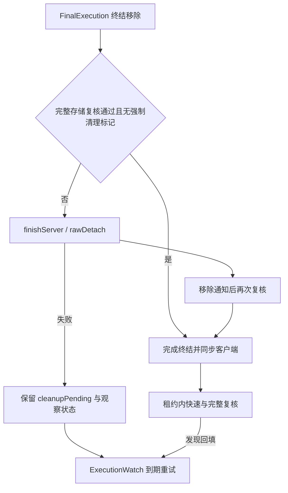

# 终结存储清理与实例保护

本文补充 [复活与终结](../模块/复活与终结.md) 的底层存储边界；上层死亡提交见 [死亡确认、复活与终结](死亡确认复活与终结.md)。第三方实体容器需单独核验。

## 接口与协调

[ExecutionStorage](../../../../src/main/java/com/thelongtravail/valley/ExecutionStorage.java) 是注入世界及其容器的清理/复核接口。erase / contains 执行完整路径，eraseKnown / containsKnown 在分区层只检查实体当前坐标对应的 section；present 用于多个待观察实例的批量存在性复核，不是全世界实体删除接口。

[ExecutionCleanup](../../../../src/main/java/com/thelongtravail/valley/ExecutionCleanup.java) 的 rawDetach 拒绝 Player，先设置 KILLED，再删除存储记录，随后解绑乘骑、清空 levelCallback、设置 isAddedToWorld=false，最后检查 KILLED 且目标已不在对应存储中。清理不是事务：中途失败可能已移除部分记录，但存储清理成功前不会主动丢弃原回调。

finishServer 要求服务器线程。它在 rawDetach 后按原 isAddedToWorld 状态调用移除通知，再处理动态事件监听器和计分板。onRemovedFromWorld、EntityLeaveLevelEvent 分别捕获 RuntimeException 并记录；通知后完整复核，若回调重新插入旧实例则再次 rawDetach。动态监听器异常记录后继续，计分板调用没有同样的局部捕获。

## 容器 → 擦除入口 → 复核条件

下表均指当前内存容器，不代表直接扫描或删除区块磁盘文件。

| 容器 / 源码桥接 | 擦除行为 | 存在性与实例保护 |
|---|---|---|
| ServerLevel：[ExecutionServerLevelMixin](../../../../src/main/java/com/thelongtravail/mixin/ExecutionServerLevelMixin.java) | 依次清 tick 列表、持久实体管理器、导航 Mob、父实体对应的部件、ChunkMap 追踪 | 导航正在迭代且包含目标时先抛异常延后；导航实际删除用 `==`，部件按 parent `==` |
| PersistentEntitySectionManager：[ExecutionManagerMixin](../../../../src/main/java/com/thelongtravail/mixin/ExecutionManagerMixin.java) | 清 section、visibleEntityStorage，再按条件移除 knownUuids | visible UUID 映射仍有实例时保留 UUID 标记；无可见实例而 knownUuids 含 UUID 视为残留 |
| EntityLookup：[ExecutionLookupMixin](../../../../src/main/java/com/thelongtravail/mixin/ExecutionLookupMixin.java) | 分别处理 byId、byUuid | 仅当键当前对应值 `==` 目标才删除，不因键相同就删除新实例 |
| EntityTickList：[ExecutionTickListMixin](../../../../src/main/java/com/thelongtravail/mixin/ExecutionTickListMixin.java) | active 正在迭代时先复制；passive 未被迭代才删除 | 键值引用必须相同；contains 只查 active，旧迭代快照可暂存目标 |
| EntitySectionStorage：[ExecutionSectionsMixin](../../../../src/main/java/com/thelongtravail/mixin/ExecutionSectionsMixin.java) | 完整模式遍历所有 section；Known 只查当前位置；空 section 同步移除 sections/sectionIds | 检查 section 是否实际含该对象，处理坐标与存储分区不一致需完整模式 |
| EntitySection：[ExecutionSectionMixin](../../../../src/main/java/com/thelongtravail/mixin/ExecutionSectionMixin.java) | 委托 ClassInstanceMultiMap | 不另作 UUID 删除 |
| ClassInstanceMultiMap：[ExecutionMultiMapMixin](../../../../src/main/java/com/thelongtravail/mixin/ExecutionMultiMapMixin.java) | 对 allInstances 和 byClass 中含目标的列表复制后删除；共享列表复用同一替换结果 | 逐元素按 `==`；旧迭代器继续持有旧列表，保留 FastList 类型要求 |
| ChunkMap：[ExecutionChunkMapMixin](../../../../src/main/java/com/thelongtravail/mixin/ExecutionChunkMapMixin.java) | 核对 tracked.entity 后，对 seenBy 快照逐人 removePairing，再清 seenBy | 回调结束重新检查 entityMap 中仍是原 tracked 对象才删除；避免回调注册同 ID 新追踪器后被删 |
| ClientLevel：[ExecutionClientLevelMixin](../../../../src/main/java/com/thelongtravail/mixin/ExecutionClientLevelMixin.java) | 清 tickingEntities、临时实体管理器及 parent 对应部件 | 复用引用校验；不含服务器导航、knownUuids 和服务器追踪器 |
| TransientEntitySectionManager：[ExecutionTransientMixin](../../../../src/main/java/com/thelongtravail/mixin/ExecutionTransientMixin.java) | 清 sectionStorage 与 entityStorage | 完整/Known 区别同分区层 |

[ExecutionTrackedAccessor](../../../../src/main/java/com/thelongtravail/mixin/ExecutionTrackedAccessor.java) 提供追踪实体、ServerEntity 和 seenBy 引用；[ExecutionRawEntity](../../../../src/main/java/com/thelongtravail/mixin/ExecutionRawEntity.java) 提供移除原因、乘骑、回调与入世标记。它们暴露字段，不自行证明清理完整。

knownUuids 仅是 UUID 集合，不能单独证明归属哪个实例。当前保护条件是“可见 UUID 映射仍有实例则保留”；不能推广为对第三方所有不可见同 UUID 状态都有完备保护。

## 旧快照、回填与保存拦截

为了不破坏正在运行的迭代器，tick 列表和分类列表允许旧快照暂存旧对象。因此 detached 表示当前受管存储复核通过，不代表所有外部引用或历史快照都已消失。

配套拦截如下：ServerLevel 的 tickNonPassenger / tickPassenger 跳过 cleanupPending 或 terminated 实例；[ExecutionTrackingMixin](../../../../src/main/java/com/thelongtravail/mixin/ExecutionTrackingMixin.java) 阻止该类实例 addPairing、sendPairingData 和 sendChanges；[ExecutionPersistenceMixin](../../../../src/main/java/com/thelongtravail/mixin/ExecutionPersistenceMixin.java) 在 saveAsPassenger 返回 false；ServerLevel.save 前触发观察器完整 sweep。这些入口不等于控制第三方任意直接序列化或私有缓存。

[FinalExecution.retryCleanup](../../../../src/main/java/com/thelongtravail/valley/FinalExecution.java) 排除玩家、无 pending、已有执行作用域和非服务器线程等条件。重试进入 terminate 移除/清理阶段，不重跑上层伤害与死亡提交；这不保证第三方移除回调恰好执行一次。

[ExecutionWatch](../../../../src/main/java/com/thelongtravail/valley/ExecutionWatch.java) 按世界保存旧 LivingEntity 弱引用。快速检查走 Known；深度检查遍历全部分区，可将多个目标合并为 identity set 批量查询。批量查询失败退回逐个复核，清理可能触发回调时废弃旧批量结果。普通深度检查间隔为观察时钟 100，保存前 force 扫描；安静时快速探测退避至最多 20，异常退避至最多 200。没有固定总耗时预算，不能将间隔理解为单 tick 开销上限。

[ExecutionLease](../../../../src/main/java/com/thelongtravail/valley/ExecutionLease.java) 初始有效期最多 200 游戏 tick，并受配置总期限约束；回填或修复异常将有效期扩至总期限，不无限续期。过期后移除观察条目，世界卸载清理观察表。实例上的隔离标记与观察租约不同，租约过期不自动撤销该实例标记。

## 客户端身份保护的不同边界

[ExecutionTerminationClient](../../../../src/main/java/com/thelongtravail/client/ExecutionTerminationClient.java) 收到终结通知后，先检查维度，再由 [ExecutionReceipts](../../../../src/main/java/com/thelongtravail/valley/ExecutionReceipts.java) 记录世界对象内的实体 ID、UUID 和有效期；直接清理还要求实体为非玩家 LivingEntity 且 UUID 匹配。ClientLevel 加入、tick 及 [ExecutionRenderMixin](../../../../src/main/java/com/thelongtravail/mixin/ExecutionRenderMixin.java) 的 shouldRender/render 都可抑制匹配实例。

因此，同 UUID 但不同实体 ID 的客户端新对象不会仅凭 UUID 命中；同 ID 但不同 UUID 也不会命中。**租约内同时复用 ID 和 UUID 的新对象仍会被当作重现目标抑制**，这里没有区分新对象世代的额外标识。服务端观察器的旧对象引用保护不能直接套用为客户端承诺。回执每次 probe 最多检查 64 条，卸载清理，过期不再匹配。

## 扩展与验证

新增容器桥接必须配对实现 erase/contains，说明 Known 与完整模式的差异、引用相等规则、回调重入及迭代安全；单纯按 UUID 删除或使用依赖 equals 的条件删除不足以复用当前保护契约。

回归关注点：同 ID/UUID 新实例、追踪移除回调替换 tracker、错位 section、正在遍历的 tick/导航/分类列表、清理中异常及租约耗尽、乘骑解绑、保存前回填、客户端乱序通知与 ID 复用。

[返回项目书](../README.md)
