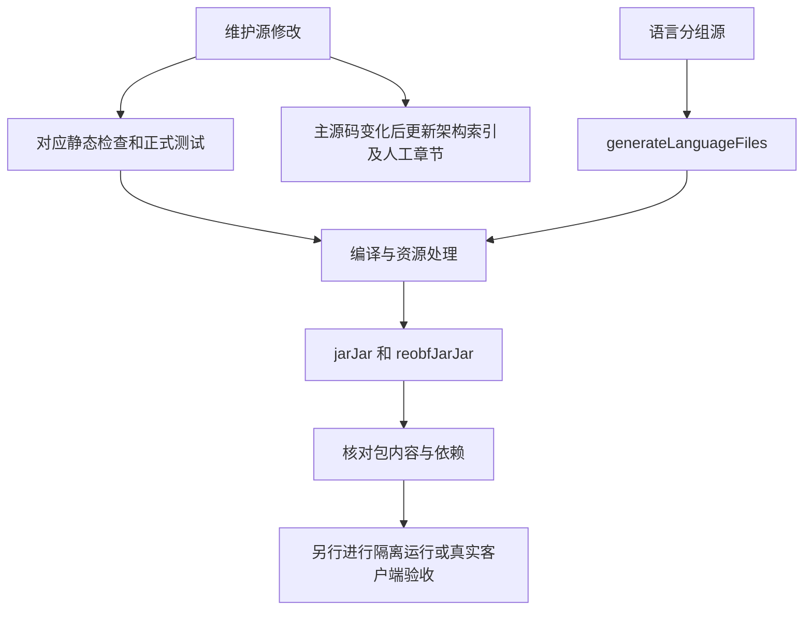

# 维护到构建的检查路径

后续已补齐功能回归入口、进程防护、持续生命周期及原始发布 JAR 组合验证。当前范围见 [当前状态与验收边界](../维护/当前状态与验收边界.md)，完整运行命令见 [隔离回归说明](../../../../tools/structure-regression/README.md)。历史本机工具仍按各自范围管理，新增入口不代表所有 tools 已验收。

核对日期：2026-10-24。下列命令在仓库根目录运行；各项执行结果见当前状态页。

## 按改动选择检查

| 修改内容 | 优先命令 | 能说明什么 |
|---|---|---|
| 架构章节或分类 | `node docs/开发者查阅/架构/维护/generate.mjs --check` | 索引与当前主源码一致、本地链接目标存在；不验证标题锚点或语义 |
| Java 职责/文件发生变化 | 先运行同一生成器，不加 --check，再检查 | 更新索引；人工链路仍需自行复核 |
| 语言源 | `node tools/verify-language-files.cjs` | 语言文件契约检查，不能验证游戏实际排版 |
| 语言生成器 | `node tools/test-language-generation.cjs` | 无效输入与生成稳定性 |
| 配置基础 | `.\gradlew.bat testConfigLayout testConfigRecovery testConfigDiagnostics` | 对应正式测试类；不证明真实热重载及客户端同步 |
| 可选契约 | `.\gradlew.bat testOptionalCompatibility` | 测试代码定义的契约；真实 JAR 可通过 compatTestJars 参数补充 |
| 正式构建与检查 | `.\gradlew.bat build jarJar` | 构建、已接入 check 的任务与正式打包；不自动执行本机 tools 的全部验证 |

JDK 17、Node.js 18+ 与 Gradle Wrapper 的环境说明见 [项目 README](../../../../README.md#源码构建)。首次解析依赖需要网络，只有缓存齐全才能使用 --offline；不要把“离线构建失败”直接判定为源码错误。Node 可通过 nodeExecutable 参数指定，女仆 API 可通过 maidApiJar 参数替代。

## 检查不是同一条流水线

项目书生成器没有接入 Gradle check。语言生成则是 processResources 的依赖，并接入 check；配置与兼容检查通过各自脚本加入 check。项目书一致性检查与构建检查分别执行。

当前 build.gradle 将 jar 的 classifier 设为 slim，将 jarJar 的 classifier 置空并绑定重混淆后置任务。应按 [项目 README](../../../../README.md#源码构建) 选择正式包；带 slim 的包不含相同内嵌依赖。本轮没有生成、替换或部署 JAR。

## 留下可复核的结果

验证记录至少写明源码版本/指纹、命令、运行环境、结果和未覆盖范围。测试未执行时明确写 NOT_RUN；客户端表现待观察写待验收，不从脚本名称或历史日志推断 PASS。

Java 索引指纹单独覆盖 src/main/java；A10 已新增资源与构建输入指纹及 Markdown 标题锚点检查，精确范围和 14 项正反例见 [维护说明](../维护/README.md)。未列入范围的测试、其他本机脚本和外部依赖仍不受保证；指纹通过不替代语义复核。

正式测试与生成器所需文件已经在可跟踪路径；本机验证资产未逐项审计。下一阶段宜从一个高价值本机检查开始，整理其依赖与复现说明，再决定是否纳入正式测试，不宜整体迁移或批量清理。

[返回项目书](../README.md)
