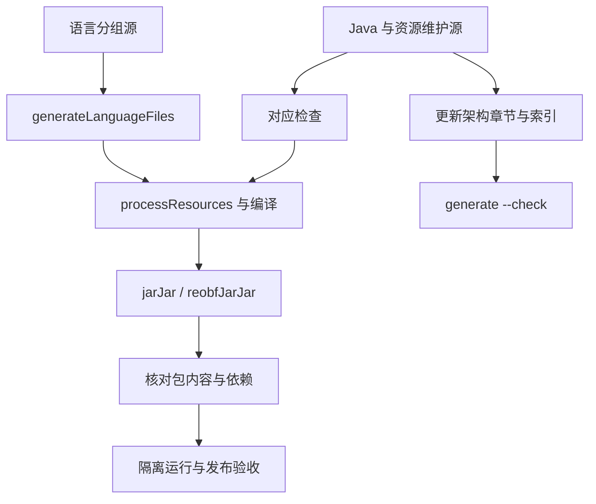

# 维护到构建的检查路径

按改动范围选择检查，在仓库根目录执行。构建环境见 [项目 README](../../../../README.md#源码构建)：Java 17 编译目标、Node.js 18+ 和 Gradle Wrapper。离线构建需要完整依赖缓存；Node 可通过 nodeExecutable 指定，女仆 API 可通过 maidApiJar 替代。

## 按改动选择检查

| 修改内容 | 命令或入口 | 检查范围 |
|---|---|---|
| 架构章节或分类 | `node docs/开发者查阅/架构/维护/generate.mjs --check` | Java 索引、资源与构建指纹、本地链接和 Markdown 标题锚点 |
| 主源码或指纹范围内的输入 | 更新对应人工章节，再运行同一生成器（不加 --check） | 重新生成四份索引文件 |
| 文档检查器 | `node docs/开发者查阅/架构/维护/test-checks.mjs` | 14 项正反例，含文件增删、指纹变化、链接和锚点 |
| 语言源 | `node tools/verify-language-files.cjs` | 语言键、参数与文件契约 |
| 语言生成器 | `node tools/test-language-generation.cjs` | 无效输入和生成确定性 |
| 配置基础 | `gradlew.bat testConfigLayout testConfigRecovery testConfigDiagnostics` | 配置布局、恢复与诊断测试 |
| 可选契约 | `gradlew.bat testOptionalCompatibility` | 可选接入契约；compatTestJars 可指定目标 JAR |
| 构建与打包 | `gradlew.bat build jarJar` | check 所接任务、编译、资源处理与正式打包 |
| 隔离运行 | [结构回归说明](../../../../tools/structure-regression/README.md) | 基础、配置、战斗、女仆、重启及专项组合 |
| 自然生成预设 | [世界生成检查](../../../../tools/worldgen-presets/README.md) | 目标注册、自然生成和到访检测等指定场景 |

## 构建装配

语言生成接入 processResources，语言、配置和兼容检查接入 check。项目书索引检查独立执行。精确输入范围见 [项目书维护](../维护/README.md)。

build.gradle 将 jar 标记为 slim，将 jarJar 的 classifier 置空，并绑定重混淆任务。正式包按 [源码构建说明](../../../../README.md#源码构建) 选择；slim 不包含同样的内嵌依赖。

## 验证记录

每次验证记录源码版本或指纹、命令、环境、结果和覆盖场景。构建检查、隔离运行、客户端观察及部署验收各自记录结果，未执行项标为待验收。既有结果见 [当前状态与验收边界](../维护/当前状态与验收边界.md)。

[返回项目书](../README.md)
