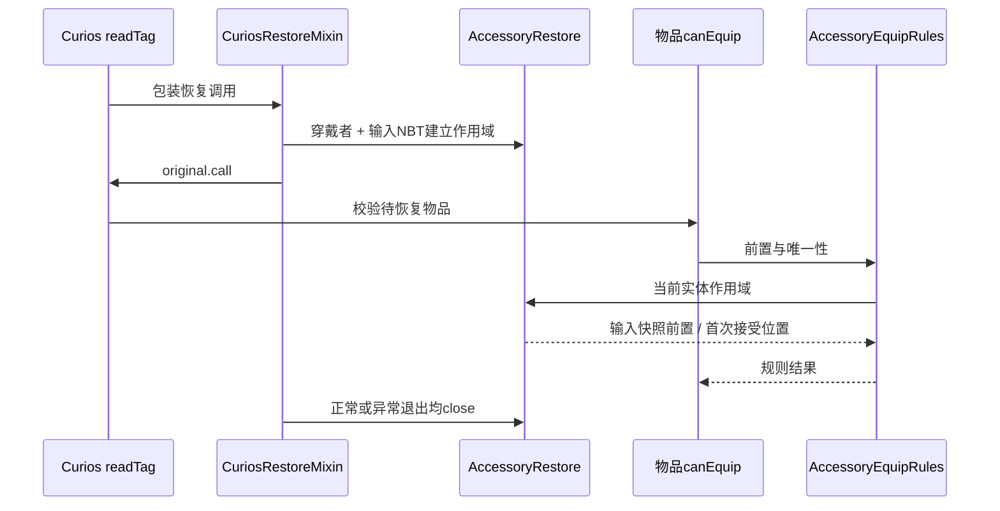

# 装备恢复与依赖返还

核对日期：2026-10-24；静态源码核对，未重跑运行测试。职责见 [装备与携带](../模块/装备与携带.md)。

## 整套饰品恢复

依据：[CuriosRestoreMixin](../../../../src/main/java/com/thelongtravail/mixin/CuriosRestoreMixin.java)、[AccessoryRestore](../../../../src/main/java/com/thelongtravail/helper/AccessoryRestore.java)、[AccessoryEquipRules](../../../../src/main/java/com/thelongtravail/helper/AccessoryEquipRules.java)。Curios 恢复期契约沿用[现有接入说明](../../accessory-equipment.md)，本轮未重新验证上游版本的每个内部调用。

恢复作用域提供待恢复前置和位置占用记录，不是完整事务，也不是对全部饰品依赖的拓扑排序。输入快照中有前置不代表它最终一定装备成功；运行期的前置对账仍然必要。各物品自己的槽位/外观/绑定等规则不能省略。

## 运行期前置失效

DependentAccessories 的规则为 item supplier、requirement predicate、cleanup consumer。当前内置项为 DEMON_KING、SOUL_BANNER、PHOSPHOPHYLLITE、THOUSAND_YEARS、BOOK_OF_DEAD、LORENTZ_FANTASY、STAR_VOICE、AZRAEL，均以存在当前日记为前置；不是所有主题物品都在此清退。

reconcile 由服务端 PlayerTick END 调用，也可由道具在真实槽位变更完成后主动调用：

1. 用 CHECKING 按玩家对象防重入，遍历规则快照。
2. 前置成立跳过；否则先执行 cleanup，再取得 Curios 库存。
3. 收集对应非外观物品的槽名、索引与类型，形成位置快照。
4. 对每个位置重新检查前置、当前 handler、索引与物品类型，避免使用旧 ItemStack 引用。
5. 复制物品并清空原槽，再经 TravailCurios.returnToInventoryOrDrop → ItemDelivery.give 返还。
6. finally 释放 CHECKING。

cleanup 在检查该物品是否实际装备之前执行，因此前置不成立时可能每刻被调用；不能在里面无条件发奖励、累计惩罚或重置其他来源状态。异常会向外传播并释放重入标记，但没有自动回滚已执行的清理或已移除的物品。

依据：[DependentAccessories](../../../../src/main/java/com/thelongtravail/helper/DependentAccessories.java)。注册应在初始化阶段一次完成，现有 register 不去重也不是并发注册接口。

## 归乡与缩槽

[HomecomingItem.use](../../../../src/main/java/com/thelongtravail/item/HomecomingItem.java) 是专用卸下路径：定位日记和当前槽位，复制日记、清空槽位，非创造模式消耗手持归乡，返还日记，移除额外槽位，再主动 reconcile 依赖饰品，最后标记/广播及反馈。它直接处理库存，不通过普通 canUnequip 决定能否归乡。

消耗早于返还是重要次序：背包插入可能复用刚清空的手持槽，因此返回结果使用该槽当前 ItemStack，而非最初手持引用。正常 NBT 更新触发的 onUnequip 不能代替这一明确的移除流程。

额外槽位减少由 TravailCurios.reconcileExtraSlots 先疏散末尾功能槽，再改本来源 UUID 修饰。归乡主动清退依赖；其他普通变化由既有事件和 Tick 协作处理，不保证每次 NBT 回调立即清退所有物品。

## 返还能力的保证范围

[ItemDelivery.give](../../../../src/main/java/com/thelongtravail/common/ItemDelivery.java) 根据最大堆叠拆分副本，经 PlayerMainInvWrapper 插入主背包，剩余调用 player.drop。它避免直接使用创造模式下可能吞掉溢出的 Inventory.add；但它没有确认外部事件是否取消掉落，也没有持久化补偿队列。

因此“尝试返还背包或掉落”不等于“任何第三方环境都保证永久投递成功”。如果需要更强保证，应作为独立设计任务讨论，不能在架构文档中承诺现有实现没有的事务语义。

## 维护检查

- 变更恢复逻辑：核对 readTag Mixin 注册、作用域退出、实体隔离、unique 的调用顺序。
- 变更前置：同时核对 canEquip 和持续失效规则，两者不是同一个入口。
- 变更槽位：核对本来源修饰、缩槽疏散、Curios 功能与外观库存、其他模组修饰。
- 变更投递：复查归乡及其他 ItemDelivery/returnToInventoryOrDrop 使用者，尤其手持槽复用和异常路径。
- 扩展携带：保持与日记装备判定分离，明确 UNKNOWN，不将携带故障直接当作不存在。

[返回项目书](../README.md)
