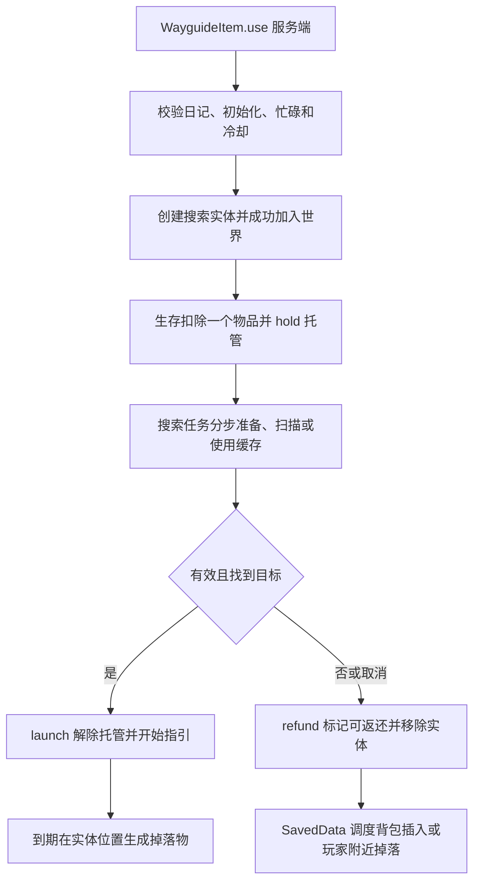

# 路引搜索与返还

空间查询原理见 [探索查询与路引](../模块/探索查询与路引.md)。

## 从使用到结果

入口为 [WayguideItem.use](../../../../src/main/java/com/thelongtravail/item/WayguideItem.java) → [WayguideSearch.use/tick](../../../../src/main/java/com/thelongtravail/data/WayguideSearch.java)。use 会先将当前已加载区块的群系尝试计入到访，再选择缓存/扫描器。实体创建或加入世界失败时不扣物品；成功加入后生存玩家扣一个，reserve 保存单件物品副本和托管记录。创造玩家不扣除，也不产生待返还物品。

Task 持有玩家、实体、初始维度/位置、旅程 UUID/revision、样本上限及纳秒超时。玩家死亡/移除、换维度、日记丢失/身份变化、实体移除或距原点超过 128 格都会使任务失效。tick 在扫描后再检查超时；结算结果还要求至少经过 20 游戏 tick。失败、超时和异常均走 cancel，关闭扫描器并请求返还。

缓存绑定旅程身份、维度、原点、目标和期限；命中还要求原点距离不超过 128 格、目标在世界边界内、水平距离不超过 min(5000, 配置半径)。缓存不重新验证目标结构仍存在。成功 launch 后设置 60 tick 冷却、声音和缓存；受理任务时设置 20 tick 冷却。

## 调度、区块请求与停止

搜索任务按玩家队列轮转，使用全局采样预算；每次轮到一个任务，准备或扫描至多执行 32 次。LoadBudget 还限制新请求数为一、操作数及配置毫秒期限。外部调用已开始后不会被预算抢占，因此是软预算。

结构 ChunkRequest 持有独立 UUID 的 region ticket，申请 STRUCTURE_STARTS。cancelOwner 幂等释放票据，不取消 Minecraft 共享 future；REQUESTS 保留未完成请求并每 60 秒记录等待日志。服务器 tick 轮询完成、记录失败/异常结果并释放票据后才移除请求，因此任务已返还不代表区块生成已经结束。

[TravailEvents](../../../../src/main/java/com/thelongtravail/event/TravailEvents.java) 的服务器 END tick 依次推进搜索、自然结构确认和返还（之前还有奖励投递）。死亡、重生、跨维度、离线、日记重置及要求 INVALIDATE 的外部修改会清理相应玩家任务；登录、重生和换维度激活返还，离线 suspend 保留持久化待还记录。Stopping 清任务，Stopped 的 WayguideSearch.stopped 再释放并清空请求列表；普通 clear 不等同于 stopped。

## 物品所有权与持久化

| 阶段 | [WayguideEntity](../../../../src/main/java/com/thelongtravail/entity/WayguideEntity.java) | [WayguideReturns](../../../../src/main/java/com/thelongtravail/data/WayguideReturns.java) |
|---|---|---|
| 搜索中 | SEARCHING、owner、单件 ITEM、returnItem、escrowed | 以实体 UUID 为键 hold，ready=false |
| 搜索失败 | refund 后 finally discard | 原托管记录转 ready；无托管时 enqueue；在线玩家可立即尝试投递 |
| 搜索成功 | launch、age=0，持有成功指引的返还责任 | release 删除托管记录 |
| 指引结束 | 创建 ItemEntity 成功才清返还标记并 discard；失败每 20 tick 再试 | 正常成功指引不经过返还队列 |
| 重载搜索实体 | recoverSearch 触发 refund；缺少所属搜索任务也触发恢复返还 | 已保存的有效记录载入后全部 ready=true |

WayguideGeometry.destination 把目标方向映射为玩家脚下坐标上方 3 格、水平最多 12 格的指引位置；不是把实体送到远处目标。实体逐 tick 按剩余位移的 0.16 移动，经过配置 guideDurationSeconds 后尝试掉落。成功指引的物品掉在实体位置；失败搜索优先还背包，剩余掉在玩家附近。

SavedData 存在主世界的 the_long_travail_wayguide_returns，保存实体 UUID、owner UUID 和物品，不保存 ready。载入全部转为可返还用于恢复中断搜索。实体另外保存目标、年龄、Searching、ReturnItem、Escrowed、Owner 和 Item；运行任务、缓存、future 不持久化。不要将两个保存来源理解为跨文件原子事务或崩溃时严格恰好一次投递保证。

## 返还队列的失败边界

返还维护 pending、每 owner 的 ready 索引、唤醒队列和在线集合。每服务器 tick 全局最多尝试 16 次、每玩家 4 次、检查 32 次；失败通常延迟 20 tick 重试，每玩家配额耗尽延至下一 tick。processing / inFlight 阻止重入，剩余记录轮转，离线不丢弃 pending。

deliverOne 先插入主背包，将已插入数量从记录扣除，再广播容器变更并处理剩余掉落；生成掉落失败保留剩余记录，成功移除。这个顺序降低重复返还风险，但外部回调若在发生副作用后抛异常，不能据此宣称事务回滚。异常会记录并保留可继续处理的状态。

## 候选枚举的职责边界

结构候选游标已提取为 [WayguidePlacementCursor](../../../../src/main/java/com/thelongtravail/data/WayguidePlacementCursor.java)。随机分布按原螺旋顺序枚举，同心环结果按距离及原下标稳定排序；未完成的 future 立即返回未就绪。预算仍由 WayguideSearch 的 LoadBudget 提供，任务取消和票据释放继续由搜索调度器管理。

## 维护与验收清单

调整超时/扫描时必须保持取消进入返还，修改实体阶段时同时核对 hold/refund/release 和 NBT 恢复；修改投递时核对部分插入、失败掉落和重入。

本次仅做源码与文档检查。待游戏验收：实体生成被拒绝、搜索超时/慢 future、多人搜索与断线、满背包和部分插入、掉落生成失败重试、搜索中正常保存重启、成功指引中重启，以及异常崩溃恢复。没有重跑构建、客户端或整合包测试。

[返回项目书](../README.md)
