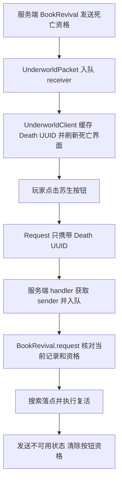
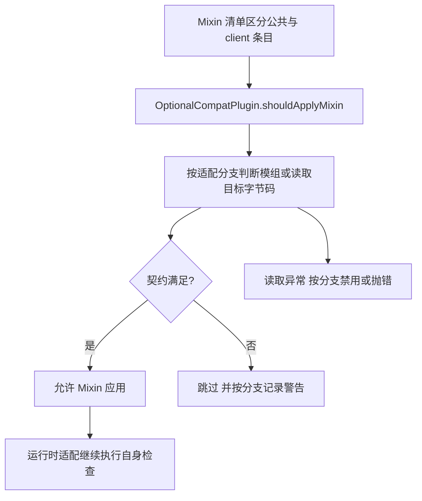

# 输入请求与可选加载

下述为介绍的实例，不代表全部消息拥有相同检查。职责地图见 [客户端与兼容](../模块/客户端与兼容.md)。

## 苏生按钮的往返

[UnderworldClient](../../../../src/main/java/com/thelongtravail/client/UnderworldClient.java) 在 DeathScreen 初始化时插入按钮，并以当时的 Death UUID 构造请求。按钮激活使用死亡界面的 delayTicker；这只是界面交互条件。服务端 [UnderworldPacket.Request](../../../../src/main/java/com/thelongtravail/network/UnderworldPacket.java) 从网络上下文取发送者，交给 BookRevival 检查死亡、Ready、UUID、重复搜索和账本资格。详细复活时序见 [死亡确认、复活与终结](死亡确认复活与终结.md)。

客户端退出会清 death；已显示的按钮和旧 UUID 不保证以后仍有效。修改界面时不得把客户端缓存当作持久化账本，也不要为省去一次判断而由客户端提供目标玩家对象。

## 施雨请求中的连接复核

[RainClient.press](../../../../src/main/java/com/thelongtravail/client/RainClient.java) 检查按下动作、无界面、窗口激活、玩家存在/存活/非旁观者及按键匹配，然后发送无负载的 RainCastPacket。

[RainCastPacket.handle](../../../../src/main/java/com/thelongtravail/network/RainCastPacket.java) 捕获 sender 和 connection，入队后再检查连接仍在线、玩家未移除、连接监听器及 connection.player 仍是同一实例、服务器在线玩家表仍指向它，最后进入 RainEvents.cast。网络线程收到包和主线程执行之间可能发生重生或退出，所以对象身份复核有实际意义。

不能据此声称每个请求包都进行了这套连接复核：Underworld 请求 handler 更简短，业务有效性由 BookRevival 检查。协议审查应逐包记录实际规则。

## 可选 Mixin 的装配过程

以 Gravestone/Caelus 为例，插件通过 OptionalCompatState.Gate.check 记录本次启动结果；缺席为 ABSENT，契约满足为 ENABLED，否则 DISABLED。Gate 只在 UNCHECKED 时探测，disable 会记录原因。

JEI 阅读覆盖层分支检查目标绘制方法是否存在，Sounds 分支检查字段、方法和声音调用布局。它们解决的是特定目标版本的注入前提，不能替代 UI 遮挡或音效去重的运行验收。未匹配到特殊分支时插件返回 true，也不能理解为自动识别了所有未来兼容目标。

## 故障定位次序

界面未出现，先查物理客户端订阅和 setup，再查本地状态、owner 及输入消费；按钮点击无效果，继续查请求注册方向、handler、当前服务器对象和业务资格；仅安装某外部模组时出错，再查 Mixin 清单、插件分支、Gate 和目标 API。不要只调整显示文本或绕过 gate 来掩盖协议/接口失配。

[返回项目书](../README.md)
