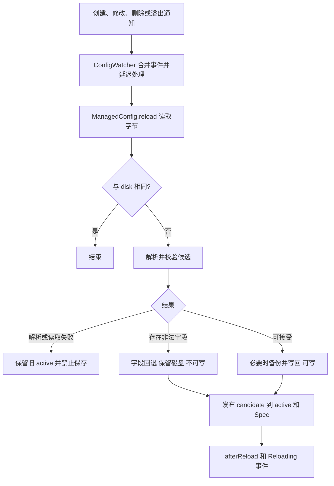

# 配置加载与重载

以下关系来自 [ManagedConfig](../../../../src/main/java/com/thelongtravail/config/ManagedConfig.java)、[ConfigRecovery](../../../../src/main/java/com/thelongtravail/config/ConfigRecovery.java)、[ConfigValidation](../../../../src/main/java/com/thelongtravail/config/ConfigValidation.java)、[ConfigWatcher](../../../../src/main/java/com/thelongtravail/config/ConfigWatcher.java) 、[ConfigReloadCoordinator](../../../../src/main/java/com/thelongtravail/config/ConfigReloadCoordinator.java) 和 [TravailNetwork](../../../../src/main/java/com/thelongtravail/network/TravailNetwork.java) 的调用关系。

## 启动加载

`ConfigFiles.register` 注册 COMMON/CLIENT 文件及事件监听。Forge 调用自定义 reader 后，`ManagedConfig.open` 进入 `ConfigRecovery.prepare`：读取原始字节 → 解析 → 特定 general.toml 迁移 → 按定义校验 → 必要时备份 → 比较原文件是否变化 → 写入 → 建立 active 和 disk 基线。

无法解析时，启动恢复使用空配置再补默认值；原文件存在且有问题时先备份原字节和错误说明。仅发生特定迁移时有独立的 `.pre-boundless-relics.bak` 路径。这里没有热重载时可保留的上一份 active。

`ConfigFileIO.write` 先生成文本；字节相同则不重复写。需要更新时在同目录写临时文件，优先原子移动，不支持时退回普通替换。写前比较是冲突检测，不是跨进程文件锁，各配置文件分别写入。

## 文件变更到配置发布

监听线程每次轮询最多等待 250 ms，收到相关通知后设置约 300 ms 的静默期限；实际生效还需完成校验与服务端调度。文件回调使用注册时的上下文 ClassLoader。ManagedConfig 的同步方法串行化本实例的操作，该锁的范围限定于当前 ManagedConfig 实例。

| 情况 | 内存配置 | 磁盘与后续写入 |
|---|---|---|
| 内容与基线相同 | 不变，不再次发布 | 不变 |
| 合法数字字符串等可修正内容 | 发布规范化候选 | 有问题记录时先归档，随后写回 |
| 普通字段不合法、错误节类型 | 非法部分使用旧有效值或默认值，其他有效修改仍可发布 | 保留本次输入字节，`writable=false` |
| TOML 无法解析或发布前读取/检查失败 | 保留此前有效配置 | 禁止后续自动保存，记录诊断；若写入阶段出错，实际文件结果需另行核对 |

缺失项由 Spec 补齐；未知键可能被 Spec 删除。修正文件后产生新的字节变更，监听可再次校验并恢复可写。运行值以成功发布的配置为准。

## 公共配置到游戏机制和客户端

Reloading 事件进入 `ConfigReloadCoordinator.onConfigReloading` 后先检查是否属于 TLT COMMON Spec；存在服务器才提交 `server.execute`，任务运行时再检查服务器是否停止。刷新次序是：

1. `RuntimePools.reload()`：诊断自动效果预算、通知高度惩罚、失效 RequirementPools，重建并发布奖励/效果/实体池，清理 JourneyQueries 和 WayguideSearch。
2. `GoldenAgeActions.reload()`、`Affection.resetAll()`。
3. 刷新每个玩家的背包菜单及不同于背包菜单的当前容器。
4. `RainEvents.configReloaded(server)`。
5. 构造提示配置快照并发送给在线玩家；构造失败返回 null 时停止这次广播，不回滚前面的机制刷新。

网络包通过 TooltipConfigCodec 校验和编码，接收端在入队处理后交给 TooltipConfigSync。它是展示用同步边界，不是将服务端全部 TOML 文件原样传给客户端。

因此至少存在“监听线程发布配置”“服务端任务刷新派生状态”“客户端接收提示”三个阶段。没有服务器时不执行此服务端刷新分支；此图也不能替代启动期间默认池补充的各自事件链。

模组总线直接注册 ConfigReloadCoordinator；TravailNetwork.onConfigReloading 保留为公开兼容转发入口，不重复注册。网络层的 broadcastTooltipConfig 只构造一次提示快照并向玩家广播；运行状态刷新仍按上列次序执行。

## 排查顺序

配置看似未生效时，先核对文件字节与诊断，区分解析失败和字段回退；再检查是否为 COMMON、服务器任务是否执行，以及具体功能读取原始配置还是派生缓存。服务端功能生效而提示未更新时，再检查快照构造和网络接收。

[模块职责](../模块/配置与运行时数据.md) · [返回项目书](../README.md)
