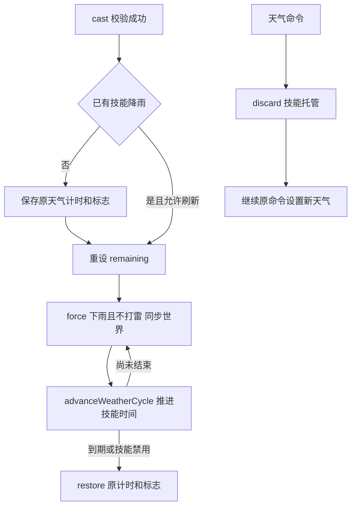

# 降雨状态与主动技能

玩家东海道五十三次主动降雨、雨天被动与天气桥接静态核对。駅只核对资格与消费入口，不重新宣称其完整战斗链或女仆兼容已审计。

## 分层与数据所有权

| 源码 | 职责 / 状态 |
|---|---|
| [TokaidoItem](../../../../src/main/java/com/thelongtravail/item/TokaidoItem.java)、[EkiItem](../../../../src/main/java/com/thelongtravail/item/EkiItem.java) | 东海道五十三次 Curios 佩戴入口；駅通过 inventoryTick 提供携带线索，不能混为两件都要求佩戴 |
| [RainState](../../../../src/main/java/com/thelongtravail/abyss/RainState.java) | 装备/携带、天气条件、駅状态、速度和抗火查询；槽位弱引用缓存与客户端快照 |
| [RainEvents](../../../../src/main/java/com/thelongtravail/abyss/RainEvents.java) | 主动施放、玩家 END tick 被动、同步与生命周期；Progress 内存保存治疗/食物累计、同 tick 请求标记和上次同步 |
| [RainWeather](../../../../src/main/java/com/thelongtravail/abyss/RainWeather.java) | 主世界 SavedData `travail_rain`，保存技能剩余时间及开始前天气快照 |
| [PrecipitationScope](../../../../src/main/java/com/thelongtravail/abyss/PrecipitationScope.java) | ThreadLocal 当前世界作用域；close 恢复上层作用域，不是永久修改 Biome 对象 |

玩家冷却保存于 persistentData 的 TravailTokaidoCooldown；技能降雨属于主世界，不绑定某个施放者持续在线。退出玩家不会撤销已施放天气。配置 [RainConfig](../../../../src/main/java/com/thelongtravail/config/RainConfig.java) 装入 aspects/abyss.toml；语言入口为 [abyss 中文分组](../../../../src/main/lang/zh_cn/aspects/abyss.json)，展示由 RainTooltips/客户端同步提供，不是服务端判定来源。

## 主动请求与重复策略

[RainClient](../../../../src/main/java/com/thelongtravail/client/RainClient.java) 仅在按下、无界面、窗口激活、有存活且非旁观玩家时请求；默认 R，也支持鼠标绑定。RainKeyboardMixin 先给逍遥游入口机会，若其消费则不再处理雨技能；雨入口本身不取消正常键鼠事件。

RainCastPacket 的原连接/玩家实例复核见 [网络协议表](网络协议与状态生命周期.md)。服务端 cast 再检查技能启用、存活、非旁观、自身库存菜单和东海道五十三次装备。同 tick 标记在维度/冷却检查之前写入；所以同 tick 被拒的尝试也可能拦住该 tick 后续请求。只允许主世界，冷却未结束拒绝。

已有技能天气时，REJECT 拒绝，REFRESH 则重设剩余时间，不累计时长，也不重新覆盖最初天气快照。自然天气是否原本下雨仅决定提示分支；自然雨并不直接阻止技能开始。成功 start 后才写入施放玩家冷却。

东海道五十三次运行资格从配置允许的 Curios 槽位 getStacks 查找，缓存命中仍核对槽位配置、索引和物品；不读取 cosmeticStacks。TokaidoItem.canEquip 的实际条件是配置槽位与唯一性，未额外写日记要求，不能套用其他主题饰品资格。

## 天气托管、结束与命令覆盖

RainWeather.start 只接受主世界。首次开始保存 clear/rain/thunder 计时、raining/thundering 标志及雨量/雷量；force 将 clearTime=0、raining=true、thundering=false，并令雨/雷计时等于 remaining。每次 advance 递减，仍活动则继续 force；到期或 SKILL_ENABLED=false 则 restore。

restore 恢复原计时与标志，不调用 setRainLevel/setThunderLevel。保存的 rainLevel/thunderLevel 字段并未在 restore 写回；不能把“保存了强度”写成“瞬间恢复旧强度”。[RainServerMixin](../../../../src/main/java/com/thelongtravail/mixin/RainServerMixin.java) 只在技能接管本次 advanceWeatherCycle 时将 RULE_WEATHER_CYCLE 查询视为 false，原版雨量/雷量插值仍继续，并未取消整个方法或修改真实 gamerule。resetWeatherCycle 在技能活动时被拦截，睡眠清天气不会直接终止托管。

[RainCommandMixin](../../../../src/main/java/com/thelongtravail/mixin/RainCommandMixin.java) 在 setClear/setRain/setThunder 开始时 discard 主世界技能记录：remaining 清零并同步，但不恢复原快照，随后由原命令接管。它不是拦截任意第三方直接写天气的通用协调器；其他写入可能在后续 force 中被覆盖。

SavedData 在普通保存中保留 remaining；停服事件只清运行缓存，不主动 restore/discard，因此正常保存重启后可继续由 advance 推进。没有崩溃前未落盘数据恢复或跨文件原子保存保证。

## 雨天条件与玩家效果

RainState.weather 要求主世界且世界标志为下雨或雷雨；按对应配置可进一步要求见天、当地群系降水类型不是 NONE。不是所有被动都要求 RainWeather.active：自然雨/雪也可能满足，而技能特有的干旱/雪地转换只在技能活动时生效。

| 使用者 | 条件与执行 |
|---|---|
| 东海道五十三次 passive | 真实装备 + TOKAIDO_LOCAL/TOKAIDO_SKY 天气条件；不要求日记 |
| RainEvents END tick | 存活非旁观且 passive 时分别累计治疗/食物计数，达到配置间隔后执行；失效清两个计数，不追补离线刻 |
| 治疗/食物回调 | 治疗回调和食物处理后将 observedPassive 置 null，供同步时重新查询；food 分支仍沿进入 tick 时 active 分支推进，不能描述为所有后续逻辑都重新验证 |
| 食物恢复 | amount>0 调 food.eat，并把配置饱和度换算为参数；amount=0 且饱和度>0 则单独增加并受当前食物值限制 |
| 抗火 | [RainFireMixin](../../../../src/main/java/com/thelongtravail/mixin/RainFireMixin.java) 仅在 LivingEntity.hurt 的 FIRE_RESISTANCE 查询处补充玩家 RainState.fire；不等同向玩家添加抗火药水或全局 hasEffect 恒真 |
| 駅资格 | 日记 + 配置天气条件 + CarryingApi 携带；归墟见证区分 WITNESS/MALICE，缺任一为 INACTIVE |
| 駅消费入口 | MALICE 速度倍率由 AltitudeSpeedMixin 合并；CombatContext 读取伤害/受击状态。完整结算见 [战斗结算](../模块/战斗结算.md)，本页不扩展为全部伤害适配审计 |

玩家冷却在 RainEvents 的 END PlayerTick 到达时递减，源码没有像 DreamState 调度那样显式查询 TimeStopManager；实际冻结玩家是否产生该事件取决于更新桥接，不能只凭这段监听器承诺与梦境完全相同的暂停语义。

## 降水作用域与显示桥接

| 桥接 | 行为 |
|---|---|
| [RainLevelMixin](../../../../src/main/java/com/thelongtravail/mixin/RainLevelMixin.java) | isRainingAt 包装在 PrecipitationScope 中 |
| RainServerMixin.tickChunk | 原区块更新包裹世界作用域，影响内部降水查询 |
| [RainRenderMixin](../../../../src/main/java/com/thelongtravail/mixin/RainRenderMixin.java) | renderSnowAndRain/tickRain 包裹客户端世界作用域，保留原绘制流程 |
| [RainBiomeMixin](../../../../src/main/java/com/thelongtravail/mixin/RainBiomeMixin.java) | 作用域内技能干旱降雨令 hasPrecipitation=true、NONE→RAIN；雪地转换令 SNOW→RAIN；shouldSnow/shouldFreeze 用传入 Level 判定并禁用积雪/结冰 |

作用域采用 try-with-resources，异常/嵌套调用仍恢复先前世界。没有作用域的 Biome 查询不自动获得上述 NONE/SNOW 转换；第三方直接实现的降水渲染仍需单独验证。

## 同步、重载与清理

sync 比较玩家 ID、技能天气、干旱/雪地开关、速度、抗火及提示配置 revision，不变则不发送。syncWorld 同时发送原版开始/停止降雨、雨量、原始雷量及强制 RainPacket；原始雷量经 RainLevelAccessor 读取，避免使用已经乘雨量的 getThunderLevel。登录强制同步，换维度清携带/槽位提示后同步，配置重载失效提示快照并强制同步。

Clone 显式复制玩家冷却；离线移除 Progress 并清携带位置缓存；ServerStopped 清玩家表、RainState 缓存及提示快照；客户端退出清雨状态和两类提示列表。这些动作不删除主世界 RainWeather 存档。设置技能禁用是在下次 advance 中恢复天气，不是 configReloaded 同步函数直接恢复。

## 验证边界

待运行验收：自然雨/雷雨初始快照、REFRESH/REJECT、gamerule=false、睡眠、命令覆盖、干旱/雪地与屋檐、回调中卸装备、满饥饿/单独饱和度、时停期间事件、跨维度/重生、正常保存重启及第三方天气渲染。女仆与駅完整战斗矩阵仍独立待验收。

[返回六主题地图](../模块/六主题玩法.md) · [返回项目书](../README.md)
